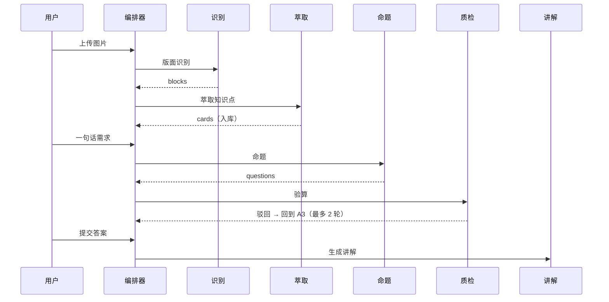

# 一纸成课（Paper2Lesson）

> 拍下任何一页纸 —— 板书、试卷、讲义、错题本 —— AI 把它变成可追问、可练习、可讲解的交互式课程。

参赛：全国大学生计算机应用能力与数字素养大赛暨第九届传智杯全国大学生数智创新与 AI 应用大赛 · **AI 创新应用挑战赛**（个人赛 / 技术应用赛）

## 它解决什么

手机相册里躺着几千张板书和试卷，复习时一张都找不到。现有工具（扫描类 App、公式识别服务）止步于「图 → 文字」：转完就结束，不能追问、不能出题、不讲解。

一纸成课补的是识别**之后**那一段：把纸面知识变成结构化卡片，再按需变成题，答错还能讲。

```
拍照 ──▶ 识别 ──▶ 萃取卡片 ──▶ 入库 ──┐
                                      ├──▶ 一句话出题 ──▶ 质检 ──▶ 交互练习卷
                                      └──▶ 追问（带出处）      │
                                                              └──▶ 答错 ──▶ 可视化讲解
```

## 快速开始

无需任何 API Key —— 缺省使用 `mock` 提供方，内置一套二次函数教学样例，整条链路可完整演示。

### 1. 后端

```bash
cd apps/server
python -m venv .venv
# Windows
.venv\Scripts\activate
# macOS / Linux
# source .venv/bin/activate

pip install -r requirements.txt
cp .env.example .env          # Windows: copy .env.example .env
python -m uvicorn app.main:app --host 127.0.0.1 --port 8710
```

### 2. 前端

另开一个终端：

```bash
cd apps/web
npm install
npm run dev
```

打开 <http://127.0.0.1:5173>。

### 3. 验证

`http://127.0.0.1:8710/api/health` 应返回：

```json
{"ok": true, "vlm_provider": "mock", "llm_provider": "mock"}
```

界面上依次点：上传任意图片 → 生成练习卷 → 答错一题 → 看讲解图。质检 Agent 会先驳回一道答案不自洽的题，再让命题 Agent 重生成 —— 这是多 Agent 存在的证据，不是故障。

### 4. 演示前重置

```bash
python apps/server/scripts/reset_demo.py
```

## 配置

复制 `.env.example` 为 `.env`。全部字段缺省即为可离线运行的最稳路径。

| 变量 | 缺省 | 说明 |
|---|---|---|
| `VLM_PROVIDER` | `mock` | `mock` / `qwen` / `glm`，视觉识别提供方 |
| `VLM_BASE_URL` / `VLM_API_KEY` / `VLM_MODEL` | 空 | OpenAI 兼容端点与模型名 |
| `LLM_PROVIDER` | `mock` | `mock` / `deepseek` / `qwen` |
| `LLM_BASE_URL` / `LLM_API_KEY` / `LLM_MODEL` | 空 | 同上 |
| `VERIFY_MAX_RETRY` | `2` | 命题 ↔ 质检回环上限 |
| `APP_PORT` | `8710` | 后端端口（与 `apps/web/vite.config.ts` 的代理目标一致） |

切换到真实模型只需改 `.env` 三行，不动代码；缺字段按默认值补，未知字段忽略。

## 架构

六个 Agent，能力异构，靠事件总线串成一条流水线：

| Agent | 职责 | 依赖 |
|---|---|---|
| 识别 | 图像 → 版面块（公式 / 表格 / 手写） | 视觉模型 |
| 萃取 | 版面块 → 知识点卡片 | 语言模型 |
| 命题 | 一句话需求 → 变式题 | 语言模型 |
| 质检 | sympy 代入验算，驳回不通过的题 | 符号计算 |
| 讲解 | 错因归因 + 选可视化模板与参数 | 语言模型 |
| 检索 | 追问时召回卡片原文并标出处 | 本地混合检索 |



每个 Agent 的状态经 SSE 推到前端看板，用户能看见谁在跑、谁把谁驳回了。

## 目录

| 路径 | 内容 |
|---|---|
| `apps/server/app/` | FastAPI 服务、编排器、六个 Agent、Provider 层 |
| `apps/server/scripts/` | 演示前重置等运维脚本 |
| `apps/web/src/` | React 前端：Agent 看板、练习卷、可视化讲解 |
| `docs/技术文档.md` | 技术文档正文（提交版 PDF 由此导出） |
| `docs/ai-logs/` | 与 AI 的核心对话快照（提交物） |
| `data/` | 运行数据（SQLite / 上传图片），不入库 |

## 边界与诚实声明

- `mock` 模式下的识别与命题结果是**内置教学样例**，用于无密钥演示；切到真实模型后才处理真实图片。
- 生成题目的正确性由质检 Agent 用 sympy 表达式代入验算，未通过的题会在界面标记 `未验算`，不隐藏。
- 识别结果允许人工修正（后续版本），不确定的内容标 `[无法识别]`，不猜。

## 红线

- 仓库不含任何内网地址、域名、账号口令、token 与个人身份信息。
- 每个 commit 对应一个功能模块或一次与 AI 的核心会话，不补历史、不改时间戳。
