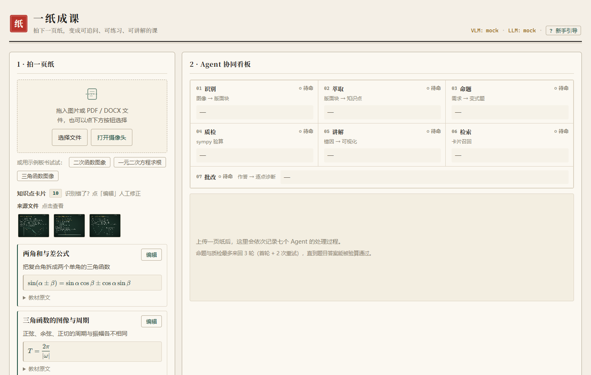
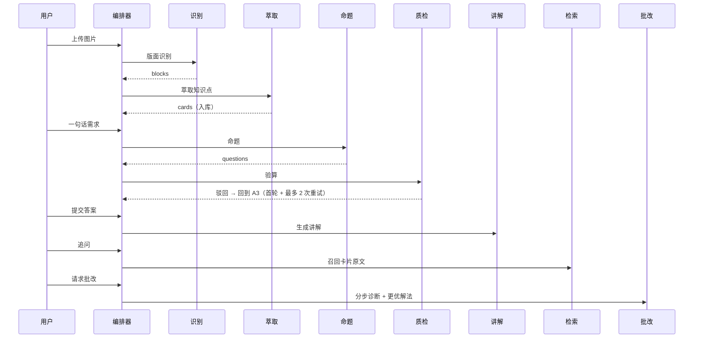

# 一纸成课（Paper2Lesson）

> 拍下任何一页纸 —— 板书、试卷、讲义、错题本 —— AI 把它变成可追问、可练习、可讲解的交互式课程。

参赛：全国大学生计算机应用能力与数字素养大赛暨第九届传智杯全国大学生数智创新与 AI 应用大赛 · **AI 创新应用挑战赛**（个人赛 / 技术应用赛）



> 截图取自当前「纸墨讲义风」界面（七个 Agent，含批改），数据由 `scripts/prepare_demo.py` 预置。

## 它解决什么

手机相册里躺着几千张板书和试卷，复习时一张都找不到。现有工具（扫描类 App、公式识别服务）止步于「图 → 文字」：转完就结束，不能追问、不能出题、不讲解。

一纸成课补的是识别**之后**那一段：把纸面知识变成结构化卡片，再按需变成题，答错还能讲。

```
拍照 ──▶ 识别 ──▶ 萃取卡片 ──▶ 入库 ──┐
                                      ├──▶ 一句话出题 ──▶ 质检 ──▶ 交互练习卷
                                      └──▶ 追问（带出处）      │
                                                              └──▶ 答错 ──▶ 可视化讲解
```

## 环境要求

| 依赖 | 版本 |
|---|---|
| Python | ≥ 3.11（`fastapi==0.163.0` 要求 ≥ 3.11） |
| Node.js | ≥ 18（Vite 5 要求；前端单测 `npm test` 用到 TS 类型擦除，需 ≥ 22.6） |

## 快速开始

无需任何 API Key —— 缺省使用 `mock` 提供方，内置三套教学样例（二次函数 / 一元二次方程 / 三角函数），按上传文件名分流，整条链路可完整演示。

### 1. 后端

```bash
# 在仓库根目录执行
cp .env.example .env          # Windows: copy .env.example .env

cd apps/server
python -m venv .venv
# Windows
.venv\Scripts\activate
# macOS / Linux
# source .venv/bin/activate

pip install -r requirements.txt
pip install -r requirements-dev.txt   # 只有跑测试时才需要（pytest）
python -m uvicorn app.main:app --host 127.0.0.1 --port 8710
```

> `.env` 放在**仓库根**（`config.py` 只从根目录加载），不是 `apps/server/` 下。

### 2. 前端

另开一个终端：

```bash
cd apps/web
npm install
npm run dev
```

打开 <http://127.0.0.1:5173>。

### 3. 验证

`http://127.0.0.1:8710/api/health` 应返回：

```json
{"ok": true, "vlm_provider": "mock", "llm_provider": "mock",
 "vlm_ready": true, "llm_ready": true, "ready": true}
```

`ready` 为 false 表示选了真实模型却没给 Key —— 这时接口会明确报错，而不是静默回退 mock。

界面上依次点：上传任意图片（或用「打开摄像头」拍一页）→ 生成练习卷 → 答错一题 → 看讲解图。质检 Agent 会先驳回一道答案不自洽的题，再让命题 Agent 重生成 —— 这是多 Agent 存在的证据，不是故障。

### 4. 演示前重置

```bash
# 在仓库根目录执行
python apps/server/scripts/reset_demo.py
```

## 配置

全部字段缺省即为可离线运行的最稳路径。切换到真实模型只改两处：`*_PROVIDER` 与 `*_API_KEY`。

| 变量 | 缺省 | 说明 |
|---|---|---|
| `VLM_PROVIDER` | `mock` | `mock` / `qwen` / `glm`，视觉识别提供方 |
| `VLM_BASE_URL` / `VLM_API_KEY` / `VLM_MODEL` | 空 | OpenAI 兼容端点与模型名，留空用内置预设 |
| `LLM_PROVIDER` | `mock` | `mock` / `deepseek` / `qwen` / `glm` |
| `LLM_BASE_URL` / `LLM_API_KEY` / `LLM_MODEL` | 空 | 同上 |
| `VERIFY_MAX_RETRY` | `2` | 命题↔质检**重试**轮数（首轮 + 最多 2 次重试） |
| `VERIFY_STRUCTURE_CHECK` | `1` | 无 `verify` 的题做结构检查（题干/答案/题型）；设 `0` 回退「直接放行」旧行为 |
| `JUDGE_SYMPY_EQUIV` | `1` | 填空判分追加 sympy 等价判定；设 `0` 回退纯字符串/数值规则 |
| `EVENT_PERSIST` | `1` | Agent 事件落库，run 回收/重启后可回放；设 `0` 回退「事件只在内存」 |
| `EVENT_PERSIST_RUNS` | `200` | 落库事件保留最近多少个 run |
| `RETRIEVAL_MODE` | `legacy` | `legacy`=2-gram 字段加权；`hybrid`=2-gram + 向量 RRF 融合（需嵌入端点，故障自动回退） |
| `EMBED_BASE_URL` / `EMBED_MODEL` / `EMBED_API_KEY` | 空 | OpenAI 兼容嵌入端点（如本地 llama-server）；仅 `hybrid` 用 |
| `APP_PORT` | `8710` | 后端端口，改端口需同步改 `apps/web/vite.config.ts` 的 `BACKEND` |
| `WEB_CSP` | `1` | `SERVE_WEB=1` 托管前端时补 CSP 响应头；排障可设 `0` 关闭 |

缺字段按默认值补，未知字段忽略，旧配置原样能跑。v0.1.5 的新行为都带开关，关掉即回退旧行为。

## 功能

| 功能 | 说明 |
|---|---|
| 拍照 / 上传 | 摄像头直接拍（`getUserMedia`，拍照时最长边压到 1920）或选图；选择文件按原图上传，图片上限 12MB |
| **PDF / DOCX** | 支持文档输入：PDF 文本层可用则直读；乱码（扫描件/子集字体）在**接真实 VLM 时**渲染成图送视觉模型，缺省 mock 不读图、按文件名取样例；DOCX 按原文顺序解析段落与表格 |
| 知识点卡片 | 识别结果结构化成卡片，可**人工修正**（标题/摘要/公式/正文四个字段），**修正留痕**：改前/改后值落 `card_revision` 表，编辑器可查历史，徽章刷新不丢 |
| 一句话出题 | 按自然语言需求生成变式题，KaTeX 渲染 |
| 质检回环 | sympy 代入验算，不通过打回重生成；验算过程可在看板看到。**三级验算语义**：符号验算 / 结构检查 / 未验算分开标注，无 `verify` 的题不再冒充「已验算」 |
| **AI 批改** | 分数 + 命中要点 + **分步清单（标出出错的是第几步）** + 更优解法建议 + 流式评语；真实 provider 下另给**方法归因**（识别学生实际解法并判断成立性，另一种正确解法会被承认） |
| 错题讲解 | 按错因生成讲解脚本 + 可拖动参数的可视化图 |
| 追问 | 召回卡片原文作答，标注出处；可选**混合检索**（2-gram + 向量 RRF，需嵌入端点） |
| 判分 | 字符串/数值比对 + **sympy 等价判定**：`2=x`≡`x=2`、`(x-2)(x-3)`≡`x^2-5x+6`、`1/2`≡`0.5` |
| 函数图像 | 自写表达式解析器（无 eval、无绘图库），随手画任意函数 |
| 知识谱系 | 知识点按标签成图，节点大小=出题量，颜色深浅=被问次数 |
| 事件回放 | Agent 事件落库，run 回收/服务重启后重试仍走回放，不重复 POST |

## 架构

七个 Agent，能力异构，靠事件总线串成一条流水线：

| Agent | 职责 | 依赖 |
|---|---|---|
| 识别 | 图像 → 版面块（公式 / 表格 / 手写） | 视觉模型 |
| 萃取 | 版面块 → 知识点卡片 | 语言模型 |
| 命题 | 一句话需求 → 变式题 | 语言模型 |
| 质检 | sympy 代入验算，驳回不通过的题 | 符号计算 |
| 讲解 | 错因归因 + 选可视化模板与参数 | 语言模型 |
| 检索 | 追问时召回卡片原文并标出处 | 本地检索 |
| 批改 | 分步诊断 + 更优解法 + 流式评语 | 语言模型 |



每个 Agent 的状态经 SSE 推到前端看板，用户能看见谁在跑、谁把谁驳回了。

## 目录

| 路径 | 内容 |
|---|---|
| `apps/server/app/` | FastAPI 服务、编排器、七个 Agent、Provider 层、safe_math 白名单、混合检索 |
| `apps/server/tests/` | 25 个测试文件、370 个用例（`pytest` 一条命令跑完，约 70 s）：判分等价、验算三级、结构检查、检索融合、编排回环、批改归因、修正留痕、事件落库、接口 |
| `apps/web/tests/` | 18 个前端纯函数用例（`npm test`，Node 自带测试器）：上传闸门、流式字段归一、批改结论清洗、回放合成 |
| `apps/server/scripts/` | 演示前重置脚本 |
| `scripts/` | 样例生成、演示预置、**评测脚本**（`eval_verify.py` / `eval_retrieve.py`）、**端到端冒烟**（`e2e_smoke.py`，Playwright 7 条主路径） |
| `apps/web/src/` | React 前端：看板、练习卷、摄像头、函数图像、知识谱系 |
| `docs/技术文档.md` / `.pdf` | 技术文档正文与提交版 PDF |
| `docs/ai-logs/` | 与 AI 的核心对话快照（提交物） |
| `apps/web/public/samples/` | 演示用板书样例图与样例试卷 PDF（入库；三张图由 `scripts/make_samples.py` 生成）；`data/*.db`、`uploads/` 为运行数据，不入库 |

## 和同类项目的差异

GitHub 上「错题本 / AI 出题」类项目不少，但**对生成内容的正确性验证**几乎是空白。2026-11-15 用 GitHub 检索的结果：

| 检索词 | 仓库数 | 最高星 |
|---|---|---|
| `错题本 ai` | 237 | 853 |
| `handwritten math ocr` | 103 | 40 |
| `photo to quiz ai` | 16 | 3 |
| `quiz generation answer verification` | 6 | 0 |
| `sympy verification questions` | 4 | 0 |

| 维度 | 多数同类 | 本项目 |
|---|---|---|
| 生成题目是否正确 | 不验证，模型说了算 | **sympy 代入验算，不通过打回重生成** |
| 过程是否可见 | 只给结果 | 七个 Agent 实时看板，谁驳回了谁一眼可见 |
| 没有 API Key 能否跑 | 需要 OpenAI / Gemini Key | **mock 模式零依赖跑通全链路** |
| 交付形态 | Web 服务 / Docker | Web + 桌面版：zip 解压即用；另出 136.9 MB 单文件（首次自解压 36–48 s，不主推） |
| 知识沉淀 | 错题列表 | 知识点卡片 + 被问次数 + 知识谱系 |

## 评测（v0.1.5，可复现）

构造题库 + 样例卡片库上的第一组量化数字（脚本在 `scripts/`，结果 JSON 在 `scripts/eval-results/`）：

| 指标 | 结果 | 口径 |
|---|---|---|
| 验算拦截率 | **100%**（15/15） | 三套样例 15 道题把 `expect` 偏移 +1 构造错答案，全部被驳回 |
| 误驳率 | **0%**（0/15） | 同 15 道正确题全部放行 |
| 结构检查拦截率 | **100%**（5/5） | 无 verify 且结构损坏的题（空题干/空答案/坏选项）全部被驳回 |
| 攻击载荷拦截率 | **100%**（3/3） | `__import__` / 指数塔等载荷全部被白名单拒绝 |
| 检索 top-3 命中率 | legacy **80%** → hybrid **95%**（16/20 → 19/20） | 20 个问句（含同义改写与英文）× 10 张样例卡片；hybrid 用本地 BGE-M3（llama.cpp，OpenAI 兼容端点） |

```bash
python scripts/eval_verify.py                     # 无需密钥、无需服务
python scripts/eval_retrieve.py --mode legacy     # 同上
# hybrid 需先起嵌入端点并设 EMBED_BASE_URL / EMBED_MODEL
python scripts/e2e_smoke.py --shots ./shots       # Playwright 7 条主路径（先 npm run build）
```

**诚实边界**：题库是构造的（不是真实模型输出），拦截率证明「验算环节拦得住坏题」，不证明「真实模型出题的错误率」；检索评测在 10 张样例卡片上做，规模外推需另测。hybrid 唯一 miss 是一条英文跨语问句（`how to find the vertex of a parabola`），如实记录在结果 JSON 里。

## 边界与诚实声明

- `mock` 模式**不读取图片内容**：按上传文件名分流到内置的三套样例（二次函数 / 一元二次方程 / 三角函数），用于无密钥演示；文件名认不出时用二次函数那套。切到真实模型（`VLM_PROVIDER=qwen|glm`）才真正识别。
- 带 `verify` 的题全部代入验算：轮次用尽后只交付 `verified` 为真的题，其余丢弃并在 `done` 事件里报数；仅当一道都没过时才整批拒绝，不入库。**三级验算语义（v0.1.5）**：带 `verify` 的题标 `symbolic`（UI「✓ 已验算」）；无 `verify` 的题做结构检查（题干/答案/题型自洽），通过标 `structural`（UI「✓ 结构检查」），不通过同样驳回；`VERIFY_STRUCTURE_CHECK=0` 回退旧行为（直接放行，标 `unchecked`，UI 如实显示「! 未验算」）。结构检查只保证形状完整，**不保证内容正确**——内容正确性只有符号验算能给。
- 判分的 sympy 等价判定只在字符串/数值比对失败后追加，解析一律过 `safe_math` 白名单；任何解析/化简异常都退回旧规则结果，不会更宽松地误判。
- 混合检索缺省关闭（`RETRIEVAL_MODE=legacy`）；开启后嵌入端点故障自动回退 2-gram，追问不会因端点挂掉而失败。卡片向量懒计算并缓存，换模型自动重嵌。
- 人工修正只允许改四个字段（标题/摘要/公式/正文），服务端做字段白名单；卡片不存在返回 404。
- 摄像头依赖 `getUserMedia`，仅在**安全上下文**可用（`127.0.0.1` 或 HTTPS）。用局域网 IP 访问时浏览器会拒绝，此时改用「选择文件」。
- 识别不确定的内容标 `[无法识别]`，不猜。

## 提交物位置

| 提交物 | 位置 |
|---|---|
| 代码仓库 | 本仓库（Public，MIT；桌面版二进制包含 PyMuPDF，AGPL 说明见 `THIRD_PARTY_NOTICES.md`） |
| README 复现指南 | 本文件 |
| AI 对话快照 | `docs/ai-logs/`，索引见 `docs/ai-logs/README.md` |
| 技术文档 | `docs/技术文档.pdf`（正文 `docs/技术文档.md`） |
| 桌面版（可选） | [Releases](https://github.com/Td12138/yizhi-chengke/releases)：`yizhi-chengke-0.1.5-win64.zip` 解压即用（推荐，约 0.2s 出窗，200.5 MB），`YizhiChengke-0.1.5-portable.exe` 单文件（136.9 MB，首次解压 36–48s） |
| 演示视频 | 随作品在赛事平台提交，不入库 |

v0.1.5 产物校验（SHA256）：

- `yizhi-chengke-0.1.5-win64.zip`：`FAC8D985971D9614252859D45A4443165B5FFAC705DF84E75A07C7A5CEA41799`
- `YizhiChengke-0.1.5-portable.exe`：`3E60BE65D9ED56FDFDC6A0E02953D8CAEB4242D4D91D1E6EE50F15B5006C17C7`

## 红线

- 仓库不含任何内网地址、域名、账号口令、token 与个人身份信息。
- 每个 commit 对应一个功能模块或一次与 AI 的核心会话，不补历史、不改时间戳。
