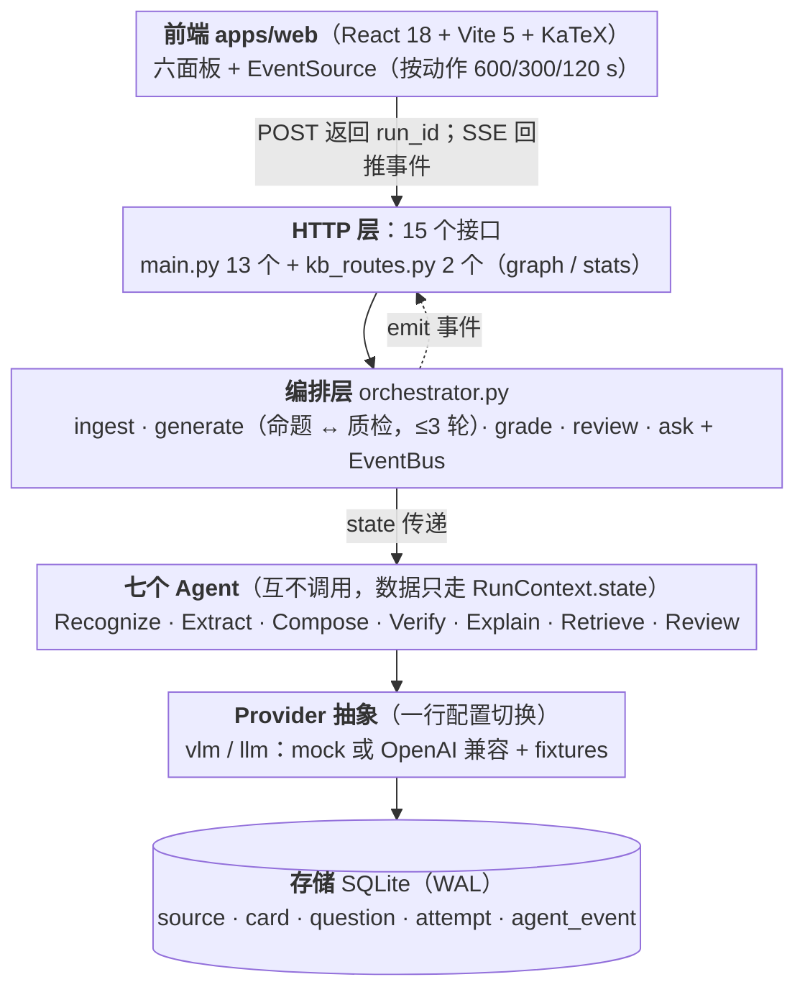
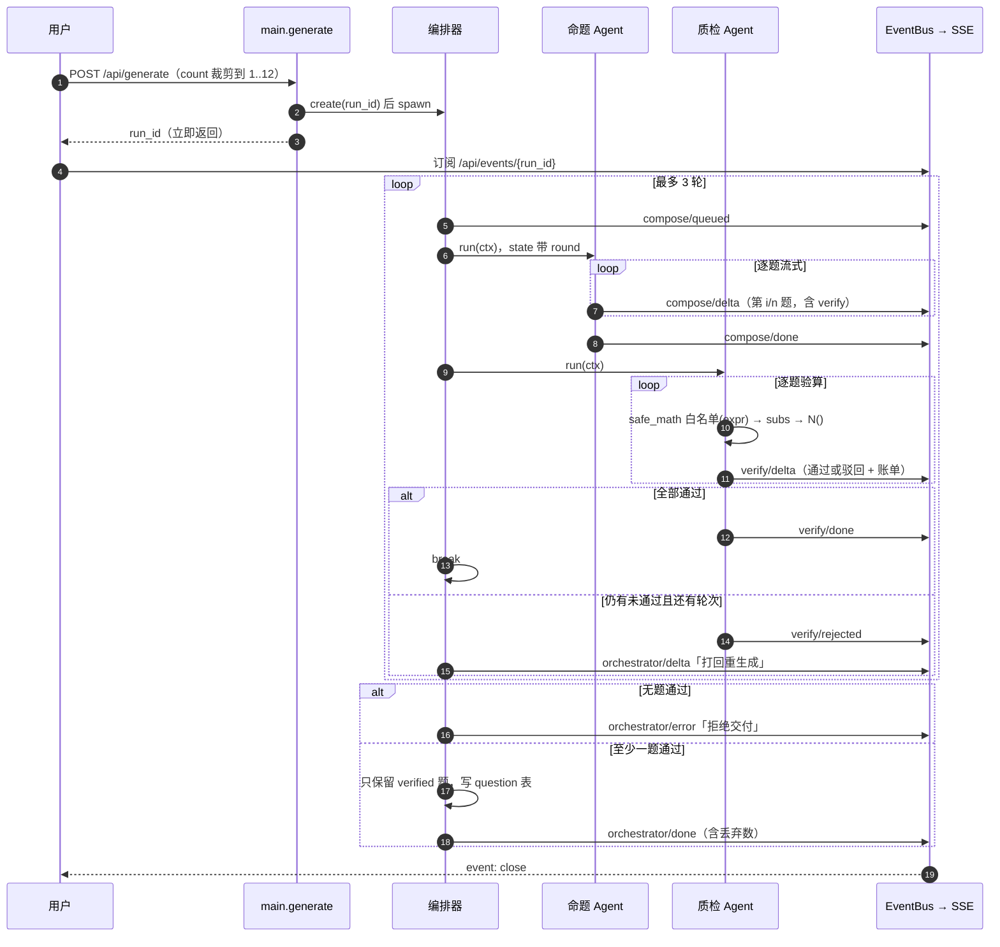

# 一纸成课（Paper2Lesson）· 技术文档

> 版本 v1.1 · 2026-11-15
>
> 阅读约定：实现结论统一给出 `文件:函数名` 或 `文件:常量名` 定位，路径相对仓库根；「缺省」= 不配置任何环境变量时的行为；未实现的部分在正文直说，并在第 7 章汇总，不用「后续将」「正在规划」一类话掩盖。

**摘要**：本作品把「拍下的一页纸」变成可追问、可练习、可讲解、可批改的交互式课程。系统由七个能力异构的 Agent 组成，核心是一处**命题 ↔ 质检回环**：命题 Agent 用语言模型出题并提交一份可核算的 `verify` 账单，质检 Agent 用 sympy 代入验算，不通过就带着轮次打回重生成，全部未通过则拒绝交付。批改 Agent 再按解题步骤给出分数、首个错误步骤与更优解法，评语真流式输出。全链路缺省走内置 mock，无密钥、无网络也能完整演示；真实模型只改环境变量。文档同时如实列出 16 条局限。

| 项 | 内容 |
|---|---|
| 作品名 | 一纸成课（Paper2Lesson） |
| 形态 | 本地运行的 Web 应用（FastAPI + React），单机单用户；另有 Electron 桌面版（内置 Python 3.14，解压即用），Web 模式仍是主路径 |
| 代码规模 | 后端 24 个 Python 文件（10 个核心模块 + base 与七个 Agent + 3 个 Provider，余为 3 个包初始化）；前端 17 个 TS/TSX（13 个组件）+ 1 份样式表 |
| 依赖 | 后端 8 个直接依赖：FastAPI、uvicorn、python-multipart、httpx、sympy、pypdf、python-docx、PyMuPDF；前端 React、Vite、KaTeX |
| 测试 | `apps/server/tests/` 共 22 个测试文件（另 `conftest.py`）、284 个用例，`pytest` 一条命令跑完（实测约 48 s） |
| 运行前提 | 无需任何 API Key：缺省 `mock` 提供方内置三套教学样例（二次函数 / 一元二次方程 / 三角函数），全链路可跑通 |

---

## 1 作品概述

### 1.1 一句话定位

**拍下任何一页纸——板书、试卷、讲义、错题本——系统把它变成可追问、可练习、可讲解、可批改的交互式课程。**

这句话里四个动词对应四段能力，缺一段产品就不成立：

| 动词 | 含义 | 落地环节 |
|---|---|---|
| 可追问 | 对纸面内容提问，答案必须带出处 | 卡入库 + `RetrieveAgent` |
| 可练习 | 按需生成变式题，答案经过独立验算 | `ComposeAgent` + `VerifyAgent` |
| 可讲解 | 答错后指出错因，并能改表达式看图形变化 | `ExplainAgent` + `FunctionSlider` / `FunctionPlot` |
| 可批改 | 按解题步骤给分，指出第一个出错的步骤 | `ReviewAgent` + `ReviewPanel` |

### 1.2 目标用户与使用场景

| 用户 | 场景 | 现有做法 | 本作品的做法 |
|---|---|---|---|
| 理工科本科生 | 课后整理板书，考前想刷同类题 | 拍照存相册，考前翻图 | 上传一页 → 生成 5 道变式题 → 答错看讲解 → 写解后看分步批改 |
| 高中生 | 错题本手抄，抄完不复习 | 手抄题干与解答 | 拍错题页 → 卡片化 → 追问「为什么这里要配方」 |
| 教师 / 助教 | 一份讲义要出随堂练习 | 手工改题号、改数字 | 一句话描述难度与题型，批量出题并逐题验算 |

这里不做用户调研数据的宣称：上述场景来自作者本人的学习过程与对现有工具的试用，样本量为 1；真实用户验证与可用性测试都没做，第 7 章 L13 如实列出。

### 1.3 主界面

前端是单页两列栅格（左栏 320–400 px，右栏主区），六个面板按使用顺序编号，代码位置 `apps/web/src/App.tsx:App`，栅格定义在 `apps/web/src/styles.css:.layout`：

| # | 区块 | 组件 / 关键函数 | 作用 |
|---|---|---|---|
| 1 | 拍一页纸 | `App.ingest`、`CameraCapture.tsx`、`CardEditor.tsx` | 拖入、选图、拍照或上传 PDF/DOCX；卡片可就地编辑并回写库 |
| 2 | Agent 协同看板 | `RunProgress.tsx`、`AgentBoard.tsx` | 阶段进度条（含已等待与按动作 600/300/120 s 上限）+ 七个 Agent 状态卡 + 日志 |
| 3 | 一句话出题 / 批改 | `App.generate`、`App.grade`、`App.review`、`ReviewPanel.tsx` | 生成练习卷；作答后给分数、分步诊断与更优解法，评语流式出现 |
| 4 | 错题讲解 | `FunctionSlider.tsx`、`FunctionPlot.tsx` | 答错后出现可拖动的二次函数图；另有自由表达式作图沙盘 |
| 5 | 追问 | `App.ask` | 回答下方列出引用卡片标题作为出处 |
| 6 | 知识谱系 | `KnowledgeGraph.tsx` | 卡片关系图 + 热度榜，节点大小/深浅表示出题量与被问次数 |

看板不是装饰：第 3 章说明它直接消费编排器发布的事件流，用户看到的「质检驳回 → 命题重生成」就是后端回环的真实投影。首次访问（或桌面版首次启动）会走四步引导，高亮上传、出题、批改、谱系四个入口。

### 1.4 演示入口

```bash
# 后端（缺省 mock，无需密钥）
cd apps/server && pip install -r requirements.txt && \
  python -m uvicorn app.main:app --host 127.0.0.1 --port 8710
# 前端（另开终端）；或 npm run build 后设 SERVE_WEB=1 由后端托管
cd apps/web && npm install && npm run dev      # http://127.0.0.1:5173
# 演示前重置数据 / 跑测试（284 个用例）
python apps/server/scripts/reset_demo.py
python -m pytest apps/server/tests -q
```

仓库另备三套演示样例（3 张板书图由 `scripts/make_samples.py` 生成，另附 1 份样例试卷 PDF；均在 `apps/web/public/samples/`），首页还有「示例板书」胶囊，点一下即可跑完整链路。`GET /api/health` 返回 `{"ok": true, "vlm_provider": "mock", "llm_provider": "mock", "vlm_ready": true, "llm_ready": true, "ready": true}` 即表示链路就绪（`apps/server/app/main.py:health`）；`ready=false` 表示选了真实模型但 Key / 地址 / 模型名至少缺一项。

### 1.5 交付物对照

| 提交物 | 本仓库对应 |
|---|---|
| 代码仓库（公开、细粒度历史） | 独立仓库，按模块与 AI 会话提交（第 8 章） |
| AI 对话快照 | `docs/ai-logs/`，现有 D0、D1 两份，每份含目标 / prompt / 输出摘要 / 判断 / 落地 |
| README（照做能跑） | `README.md`，三步启动 + 配置表 + 边界声明 |
| 技术文档（PDF ≤ 30 页） | 本文件 |
| 桌面版（可选） | `apps/desktop/`：Electron 外壳 + 内置 Python，zip 解压即用（5.6） |
| 演示视频（5–8 min） | 与本文档分开提交 |

---

## 2 需求与痛点分析

### 2.1 一条真实的学习链路，断在四个地方

把「拍下板书 → 真正学会」拆成可观测的步骤，断点一目了然：

| 步骤 | 用户动作 | 断点 | 后果 |
|---|---|---|---|
| S1 采集 | 手机拍板书 / 试卷 | 无（相机已足够好） | — |
| S2 结构化 | 想把公式、表格变成可编辑内容 | 通用 OCR 不认公式 | 图片仍是图片 |
| S3 归档 | 想按知识点归类 | 手打标签成本高，还要判断「这页讲了几个知识点」 | 相册里 1000 张图，复习时一张都找不到 |
| S4 练习 | 想找同类题练手 | 手上只有原题，没有变式 | 看完就忘 |
| S5 归因 | 做错了想知道错在哪 | 没有讲解，或讲解与自己的错法不对应 | 同一错误重复犯 |

现有工具集中在 S2，且多数停在 S2。**缺口不在识别，在识别之后**——如果只是把 S2 做得更准，作品与公式识别服务没有本质区别。

### 2.2 现有工具对比

对比维度按「学生真正需要什么」取，不按厂商宣传页取。「扫描类 App」指以扫描、去底、OCR 导出为主的一类移动应用，不针对具体产品；「本项目」列按当前实现如实填写，未实现的一律标 —。

| 维度 | 公式识别服务 | 扫描类 App | 本项目 |
|---|---|---|---|
| 主要输入 | 截图 / 图片 / PDF | 拍照 | 图片 / 摄像头 / PDF / DOCX |
| 主要输出 | LaTeX / Markdown | 增强图片、PDF、可复制文本 | 知识点卡片 + 练习卷 + 讲解 + 批改 |
| 公式 → LaTeX | 是（强项） | 部分支持 | 部分（VLM 一次生成；缺省 mock 不处理真实图片） |
| 版面切块 | 部分（以行/块为主） | — | 是（四类块 + 提示词约束） |
| 知识点归档 | — | — | 是（一页 → 多卡，带 tags/subject） |
| 按需生成变式题 | — | — | 是（自然语言需求 + 题量） |
| 答案独立验算 | — | — | 是（sympy 代入，未通过打回重生成） |
| 分步批改 / 错因 | — | — | 是（得分点 + 首个错误步骤） |
| 错因讲解 / 可视化 | — | — | 部分（一个滑块模板 + 一个表达式作图器） |
| 带出处的追问 | — | — | 是（召回卡片原文并标出处） |
| 离线可用 | 否（依赖云服务） | 是 | 是（缺省全 mock，零网络） |
| 数据归属 | 上传到厂商 | 本地为主 | 本地 SQLite + 本地文件目录 |
| 计费 | 按量订阅 | 订阅去广告 | 无（自建） |

这张表要说清的只有一句：**从「知识点归档」这一行往下，两类现有工具基本全是空白，而空白处正好是「学会」真正发生的环节。**

### 2.3 为什么缺口长期存在

1. **识别是单步映射，教学是多步状态机。** 公式识别可以定义清楚「输入图像、输出 LaTeX」的损失；「这一页该切成几个知识点、每个该配什么难度」没有唯一答案，需要生成模型 + 约束 + 校验。
2. **生成式输出天生不可信。** 一旦开始出题，就必须回答「答案对不对」，要求系统内部存在一个能**否定**生成结果的环节（符号计算）；纯 OCR 产品没有这个需求，也就没有这套设施。本项目把它做成架构主干（3.4、4.4）。
3. **工具边界与产品边界不一致。** 识别服务卖 API，扫描 App 卖存储，都不对「学生有没有学会」负责；串起 S2→S5 必须由一方持有全部数据，本地自建反而成本最低。

### 2.4 需求归纳

| 编号 | 需求 | 验收方式（当前可验证） |
|---|---|---|
| F1 | 上传一页纸（图片或文档），得到结构化版面块与知识点卡片 | `POST /api/ingest` 后 `GET /api/cards` 至少 1 张卡片 |
| F2 | 一句话描述需求，生成指定数量的题 | `POST /api/generate`，`count` 生效且被裁剪到 1–12 |
| F3 | 每道题必须经独立验算，未通过的不得静默交付 | `question.verified` + `verify_log` 写入数据库 |
| F4 | 答错给出错因与可交互图形；追问须带出处 | `POST /api/grade` 返回 `explain`；`POST /api/ask` 返回 `citations` |
| F5 | 提交解答后按步骤给分并指出首个错误 | `POST /api/review` 的 `done` 事件带 `score/verdict/steps/first_error` |
| N1 | 无密钥可完整演示，断网不崩 | 缺省 `mock`，`providers/fixtures.py` 提供全部样例 |
| N2 | 全过程可观测，用户能看见谁在跑、谁驳回了谁 | SSE 事件流 + 看板 |
| N3 | 真实模型只改配置不改代码 | `config.py` 环境变量 + Provider 抽象 |

N1 不是「降级方案」，而是刻意的主路径：比赛现场网络不可控，演示必须能在断网、无密钥、无 GPU 的机器上完整跑完（第 5 章）。

### 2.5 与同类项目的差异

2026-11-15 在 GitHub 按中文与英文关键词检索，结果说明「错题本 + AI」并不缺产品，缺的是对生成内容正确性的处理：

| 检索词 | 仓库数 | 最高星 |
|---|---:|---:|
| `错题本 ai` | 237 | 853 |
| `handwritten math ocr` | 103 | 40 |
| `photo to quiz ai` | 16 | 3 |
| `quiz generation answer verification` | 6 | 0 |
| `sympy verification questions` | 4 | 0 |

检索本身有口径限制（只统计仓库名/描述命中的公开仓库、不含私有项目与商业产品），但趋势清楚：**「错题本」有 237 个仓库、最高 853 星，「生成题 + 答案验证」只剩 6 个且最高 0 星**。差异点因此收敛为三条：

| 差异点 | 多数同类 | 本项目 |
|---|---|---|
| 生成内容的正确性 | 模型说了算，不做验证 | sympy 代入验算，不通过打回重生成，全废拒交付（3.4、4.4） |
| 过程是否可见 | 只给最终结果 | 七个 Agent 实时看板，驳回态与验算账单都可见（3.3） |
| 没有 API Key 能否跑 | 需要 OpenAI / Gemini Key | 缺省 mock 零依赖跑通全链路，断网可演示 |

除此之外还有两条工程差异：数据全部落在本地 SQLite 与本地文件目录，换模型不迁移数据；交付形态除 Web 外还有解压即用的桌面版（5.6）。

---

## 3 系统架构

### 3.1 总架构图

系统分五层，自下而上是存储、Provider 抽象、Agent、编排、HTTP/前端。Agent 之间不互相调用——所有跨 Agent 的数据传递都经由编排器持有的 `RunContext.state`，这是回环能实现的前提。

三点设计取舍：

| 取舍 | 选择 | 理由 |
|---|---|---|
| 不用 LangGraph | 自研 `asyncio` 状态机 | 三天窗口内第三方框架调试成本高于收益；回环只有「最多 3 轮」一种形态，几十行足够 |
| SSE 不换 WebSocket | 单向推送用 SSE | 事件只从服务端流向浏览器，实现成本更低；断线由前端显式提示重试，未做自动重连（3.3） |
| 不引入向量库 | SQLite + 字段加权匹配 | 演示阶段卡片是个位数，向量库的部署成本换不来收益；缺什么在第 7 章写明 |




### 3.2 七个 Agent 的职责与能力异构

「多 Agent」常被质疑为「为了用而用」。回答只有一个：**七个环节需要的不是同一个模型，而是不同的能力**，塞进一个 prompt 必然互相干扰。

| # | Agent | 输入 → 输出 | 依赖能力 | 失败模式 |
|---|---|---|---|---|
| A1 | 识别 | 图片 / 文档 → `blocks[]`（title/text/formula/table） | 视觉语言模型 + 文档解析 | 公式漏识别、表格塌陷 |
| A2 | 萃取 | `blocks[]` → `cards[]` | 语言模型 + 切分判断 | 一张卡塞多个知识点 |
| A3 | 命题 | 卡片 + 需求 + 轮次 → `questions[]` 含 `verify` | 语言模型 + 输出契约 | 答案算错、难度漂移 |
| A4 | 质检 | `questions[]` → `bool[]` + 验算日志 | sympy 符号计算 | 表达式不可解析 |
| A5 | 讲解 | 题目 + 用户答案 → 模板名 + 参数 + 文本 | 语言模型 + 模板参数化 | 参数越界导致图空白 |
| A6 | 检索 | 查询串 → 答案 + 出处卡片 | 本地检索 + 语言模型 | 无命中时硬凑出处 |
| A7 | 批改 | 题目 + 作答 → 分数 / 分步诊断 / 评语 | 语言模型 + 步骤切分 + 流式 | 步骤切不准、假流式 |

能力异构可以按「同一个错误，换个模型能不能自己发现」判断：A3 用语言模型，A4 用符号计算，A3 算错了，A4 不知道 A3 在想什么，只拿到表达式与期望值，代入一算就知道对不对——**这种独立性是设计出来的，不是巧合**。A1 的输出必须落库留档（`source.raw_json`），因为 A2 只能基于错误块往下走，错在哪要能回看。

七个 Agent 都不直接调用彼此：`agents/base.py:Agent.emit` 是唯一对外动作（发事件），`RunContext.state` 是唯一数据交换区。这条约束让回环在编排器里实现，Agent 保持无状态、可单测。

### 3.3 编排器与事件流

一次用户动作 = 一个 `run_id` = 一串事件。HTTP 层只做三件事：校验入参、创建 `Run`、把协程丢进后台（`main.py:spawn`）。

```python
# main.py:generate（节选）
count = max(config.QUESTION_MIN, min(config.QUESTION_MAX, req.count))
run_id = new_run_id()
bus.create(run_id)                     # 先建 Run，再 spawn
spawn(orchestrator.generate(run_id, req.card_ids, req.requirement, count))
return {"run_id": run_id}              # 立即返回，不阻塞
```

**先建 Run 再 spawn 的顺序很关键。** 前端拿到 `run_id` 才去订阅，中间有几十毫秒空窗；若先启动任务后建 Run，早期事件会丢。系统用「事件历史 + 游标重放」消除竞态（`events.py:EventBus.stream`）：迟到订阅者从 `run.history[0]` 补齐，每 15 s 发一次 `: keepalive` 防中间层断流，结束时补 `event: close`。

| 项 | 取值 | 位置 |
|---|---|---|
| 事件字段 | `run_id / agent / phase / message / payload / ts` | `events.py:Event` |
| phase 枚举 | `queued / running / delta / done / rejected / error` | `events.py`、`web/src/types.ts` |
| 单次运行事件上限 | 500 条，超出丢弃但不阻塞 | `events.py:MAX_EVENTS_PER_RUN` |
| 保活 / 前端超时 | 15 s / 按动作 600/300/120 s（超时主动放弃，避免看板卡死） | `events.py:KEEPALIVE_SECONDS`、`api.ts:RUN_TIMEOUT_MS` |
| 结束原因 | `done / error / timeout / broken` 四类，界面表现各异 | `api.ts:StreamReason` |

前端把同一份事件流喂给三个消费者：`RunProgress` 按 `STAGES` 把 Agent 映射成阶段，看「卡在第几步」与已耗时；`AgentBoard` 每个 Agent 只保留最新一条事件，覆盖写 `board[agent]`；滚动日志追加最近 200 条（`App.tsx:MAX_LOGS`）。进度条不是假动画，而是**由真实事件推导**：只要 `verify` 还是 `running`，进度就停在第二段。

`broken` 单独成一类值得说明：服务端在 `done` 之后补 `close`，正常路径前端已在 `done` 时 resolve；一旦走到 `broken`，说明连接真的断了，界面提示「结果可能不完整，可重试」。**前端在 `onerror` 时主动关闭连接并归为 `broken`，没有实现自动重连**——浏览器 EventSource 的原生重连会重放历史，反而让界面状态难以对齐，这里选择让用户手动重试。

`phase=rejected` 是独立的橙红色态（`styles.css:.agent-rejected`）并配 `×`（`AgentBoard.tsx:PHASE_MARK`），色觉异常或投影褪色时仍能靠形状区分，这样「质检驳回」不会与「运行失败」混淆。编排器各方法同一骨架：`try / except / finally`，`finally` 必定 `bus.close(run_id)`——**任何异常路径都不能让 SSE 悬挂**；异常不抛到 HTTP 层，统一转成 `orchestrator/error` 事件（`orchestrator.py:Orchestrator._fail`）。

### 3.4 命题 ↔ 质检回环

这是整个作品的胜负手：一个 prompt 不能否定自己，两个能力不同的 Agent 可以。



```python
# orchestrator.py:Orchestrator.generate（节选）
max_rounds = config.VERIFY_MAX_RETRY + 1          # 缺省 3
for round_no in range(1, max_rounds + 1):
    ctx.state["round"] = round_no                  # 轮次传给命题 Agent
    await self._step(ctx, ComposeAgent)
    results = await self._step(ctx, VerifyAgent)
    if results and all(results):
        break
    if round_no < max_rounds:
        await self._emit(run_id, "orchestrator", "delta", "有题未通过，打回重生成")
delivered = [q for q in questions if q.get("verified")]
```

四个行为约定必须写清楚，否则容易被误解为 bug：

| 约定 | 行为 | 依据 |
|---|---|---|
| 有限重试 | 最多 3 轮（`VERIFY_MAX_RETRY=2` + 首轮） | 防止坏 prompt 或坏模型无限循环拖死请求 |
| 部分通过即交付 | 轮次用尽后只交付 `verified` 为真的题，其余丢弃并在 `done` 里报数 | 学生要的是能做的题，不是全有或全无 |
| 全废则报错 | 全部未通过时抛 `RuntimeError`，不入库 | 宁可不出题，也不交付未验证内容 |
| 轮次可见 | 命题 `running` 消息里带「第 N 轮」 | 让回环成为可观测事实，而非文档里的说法 |

`round` 参与 prompt payload（`agents/compose.py`）。这不是装饰：真实模型收到「上一轮被打回」的上下文后会改变采样；mock 则用轮次切换样例（`providers/fixtures.py:mock_questions`，`round_no==1` 时刻意留一道期望值写错的题），保证演示必然出现一次驳回。

### 3.5 一次 generate 运行的事件序列

缺省 mock、5 道题、第 1 轮 1 题不过，实测共 **34 条事件**（命题改为逐题流式后，比早期版本的 26 条多出 8 条逐题 `delta`）：

| # | agent | phase | 内容 |
|---|---|---|---|
| 1–8 | compose | `queued`→`running`→5×`delta`→`done` | 「按需求命题（第 1 轮）」→ 逐题「第 i/5 题：…」→「命题完成，交给质检」 |
| 9–15 | verify | `queued`→`running`→5×`delta` | 逐题验算，账单形如 `x**2-4*x+3 @ {'x': 2} = -1，期望 -1`；第 4 条为驳回 |
| 16–17 | verify → orchestrator | `rejected` → `delta` | 1 道未通过，打回命题 Agent；看板转橙红 + `×`，进度条停在第二段 |
| 18–25 | compose | 同 1–8 | 第 2 轮命题，重新逐题生成 5 道 |
| 26–32 | verify | `queued`→`running`→5×`delta` | 第 2 轮逐题验算，全部通过 |
| 33–34 | verify → orchestrator | `done` | 「5 道题全部通过验算」→「交付 5 道题」，进度条走满 |

两处细节：**驳回与失败是两种颜色**（业务判定 vs 系统异常，混色会让观众以为演示出故障）；**验算式直接进 `message`**（不是「第 1 题通过」这种结论，而是「表达式 @ 代入值 = 计算值，期望 期望值」的完整账单——结论可以伪造，账单不能）。

### 3.6 一次 ingest 的事件序列

上传图片与上传文档走同一条链，差别只在识别这一步（4.1、4.7）。以「拖入一份文本层不可用的 PDF」为例：

| # | agent | 内容 |
|---|---|---|
| 1 | recognize | `running`「读取文档：讲义.pdf」；图片则从 `queued` → `running`「识别图片」开始 |
| 2 | recognize | `delta`「文本层不可用（乱码或过短），文档共 N 页，取前 3 页渲染成图解析」（真实 VLM；mock 明说不渲染），payload 带 `blocks_count` |
| 3 | recognize | `done`「文档解析完成：N 个版面块」 |
| 4 | extract | `running`「从版面块萃取知识点」→ 逐张 `delta`「第 i/N 张：…」→ `done`「卡片已入库，可被追问检索」 |
| 5 | orchestrator | `delta`「原文件已归档：2026-11-15-二次函数的图象与性质.pdf」 |
| 6 | orchestrator | `done`「入库完成：N 张卡片」，payload 带 `cards`、`source_id`、`image_path` |

两处设计值得说明：归档放在识别与萃取之后，因为标题来自萃取结果；归档失败只发一条 `delta` 并保留临时名，不影响已入库的卡片。识别事件里写明走的是「文本层直读」还是「渲染成图」，用户因此能解释「这份 PDF 为什么慢」，而不是面对一个无差别转圈。

---

## 4 关键实现

### 4.1 输入、版面识别与原图归档

识别环节的目标不是「拿到一段文字」，而是「拿到机器能继续处理的块」，这决定了输出形状（`providers/vlm.py:VLM_SYSTEM_PROMPT`）：

```json
{"blocks": [
  {"type": "title",   "content": "二次函数的图象与性质", "latex": ""},
  {"type": "formula", "content": "y = ax^2 + bx + c", "latex": "y = ax^2 + bx + c \\quad (a \\neq 0)"},
  {"type": "table",   "content": "a>0 开口向上 / a<0 开口向下；…"}
]}
```

四类块按「下游用法」划分：`formula.latex` 直接交给 KaTeX（`MathText.tsx`）；`table` 折成单行文字，避免二维结构在 token 化后行列错位；`title` 用于切分知识点；`text` 是兜底。提示词里三条硬约束：公式必须给 LaTeX、表格压成单行、看不清的内容写 `[无法识别]` 不许猜——**幻觉比缺失更危险**，缺失用户能补，编造用户看不出。

Provider 抽象只有一层，切换成本一行配置：

```python
# providers/vlm.py:recognize
async def recognize(image_path: Path) -> list[dict[str, Any]]:
    if config.VLM_PROVIDER == "mock":
        return [dict(block) for block in fixtures.MOCK_BLOCKS]
    return await _remote(image_path)
```

`_remote` 走 OpenAI 兼容协议：图片 base64 成 `data:{mime};base64,...`，`temperature=0.0`，`response_format={"type":"json_object"}`，超时 120 s。未配置时不是静默回退 mock，而是**一次性列出缺哪几项**并抛 `RuntimeError`——静默回退会让人误以为在跑真实模型，比崩溃更坏。模型输出不保证是合法 JSON（会裹代码栅栏、会加「好的，以下是结果」），`_loads` 做两级兜底：先 `json.loads`，失败用 `\{.*\}` 截最外层对象，仍失败才抛错并回显前 200 字符；`providers/llm.py:_loads` 复制了一份——两个 Provider 失败模式不同，但容错策略一致，三天窗口里复制比抽象更不容易出错。

上传链路三道闸门全在 HTTP 层（`main.py:ingest`）：后缀白名单（图片 `.png/.jpg/.jpeg/.webp/.bmp`、文档 `.pdf/.docx/.txt/.md`，`config.KIND_BY_SUFFIX` 一张表决定类型）、体积上限（图片 12 MB、文档 20 MB，按类型给不同上限）、落盘用 `uuid4().hex + 原后缀`（避免同名覆盖，也避免把可能含个人信息的原文件名写进库）。原始文件名另传一份给编排器，mock 靠它选样例集。

识别与萃取完成后做**原图归档**（`storage.py`、`orchestrator.py:_archive_input`）：用识别出的标题生成 `<日期>-<标题>.<原扩展名>`，非法字符清掉、超长截到 40 字、重名追加 `-2`，失败就保留临时名绝不删文件；归档只作用于上传目录，仓库内置样例等外部路径一律不动。

### 4.2 知识点萃取与卡片模型

萃取是「从版面块到可检索单元」的一步。输出契约要求六个字段，各有下游用途：

| 字段 | 用途 | 谁在用 |
|---|---|---|
| `title` | 卡片标题，检索权重最高 | `db.search_cards` 标题 2.0 × token 权重 |
| `summary` | 一句话摘要，追问的默认素材 | `llm.py:_mock` 的 `body or summary` 兜底 |
| `subject` | 学科，原本留给多学科筛选 | 已入库，暂未参与检索与筛选 |
| `tags` | 标签，检索次高权重 1.5 | `db.search_cards`、谱系建边 |
| `formula` | 该知识点主公式 | `App.tsx` 卡片区 `MathText` |
| `body` | 原文细节，作为引用正文 | `RetrieveAgent` 的 `cards[]` 与 mock 回答 |

`body` 与 `summary` 分开存是刻意的：摘要适合进 prompt，正文适合作为「出处」给人看，同一份数据两种粒度。入库由 `db.insert_cards` 完成，`tags` 用 `",".join` 拼成字符串——SQLite 单表存储的常见折中，代价是标签不能单独索引（第 7 章）。卡片 ID 回填到内存对象（`agents/extract.py`），因为命题要把卡片 ID 写进 `question.card_ids`，形成「这道题考的是哪几张卡」的追溯链。`source` 表存原始块（`raw_json`），与卡片是 1:N，用户觉得「这张卡总结得不对」时可回看模型到底看到了什么块。

萃取结果允许人工修正，闭环四步：卡片点「编辑」进表单（`App.tsx` 的 `editingId`、`CardEditor.tsx`）→ 只提交**真正改过**的字段（`CardEditor.tsx:diffDraft`）→ `PATCH /api/cards/{id}` 按白名单局部更新（`main.py:patch_card`、`db.py:update_card`）→ 返回完整卡片就地替换列表项。两个细节：字段白名单只放 `title/summary/formula/body`（`db.py:CARD_PATCH_FIELDS`），`source_id`、`created_at` 改了会破坏「这张卡从哪来」的追溯链；只提交差异，打开表单没改就 `diffDraft` 返回空对象、连请求都不发，真发空 `PATCH` 也返回原卡片（`test_patch_empty_body_keeps_card` 钉住）。

**一处遗留缺口写在第 7 章不藏**：修正没有留痕。卡片表没有 `corrected_by_user`，前端「已人工修正」标签只存在会话内（`App.editedIds`），刷新即消失，原值也没备份。

### 4.3 命题约束与 LaTeX 输出

命题是被约束得最紧的一环。约束写在提示词里，真正强制执行发生在代码里。输出契约七项字段，其中 `verify` 是全部创新点的落点：

```python
# providers/llm.py:SYSTEM_PROMPTS["compose"]
'{"questions": [{"stem_latex": str, "qtype": "fill"|"choice", "options": [str],
                 "answer": str, "solution": str, "difficulty": "easy"|"medium"|"hard",
                 "verify": {"expr": str, "subs": {"x": 数值}, "expect": 数值}}]}'
```

`verify` 三元组把「这道题的答案对不对」转成「一个数值等式是否成立」：`expr` 是可被 sympy 解析的表达式，`subs` 是变量代入值，`expect` 是代入后应有的结果。这不是让模型自评（自评不可信），而是让模型**提交一份可被独立核算的账单**。四类题都能这么表达：

| 题型 | `expr` / `subs` / `expect` | 说明 |
|---|---|---|
| 求函数值 | `x**2 - 4*x + 3` / `{"x":2}` / `-1` | 直接代入 |
| 交点个数 | `(-4)**2 - 4*1*3` / `{}` / `4` | 判别式本身即表达式 |
| 化为顶点式 | `(x-2)**2 - 1 - (x**2-4*x+3)` / `{"x":5}` / `0` | 两式之差恒为 0，任取一点 |
| 对称轴 | `-(-4)/(2*1)` / `{}` / `2` | 先把 a、b 代成具体数，避免符号未赋值 |

代码侧两条强制约束：题量裁剪 `questions = (result.get("questions") or [])[:count]`（多给不要、少给不补，补题只能靠再生成）；卡片溯源回填 `question.setdefault("card_ids", card_ids)`（模型没写来源就挂到本次全部卡片上，保证每题都能回答「从哪来」）。题干用 `$...$` 行内公式而非整段 LaTeX，因为要混排中文与公式，前端只需按 `$` 切分（`MathText.tsx`）。命题结果**逐题流式**下发（`ComposeAgent` 一题一条 `delta`，间隔 `DELTA_PACE_SECONDS = 0.04`），前端因此能逐条渲染，而不是等整批出完再刷一次。

### 4.4 质检的双路验算

质检 Agent 的验算核心 `check_question` 只有 31 行（`verify.py` 全文 92 行），却是整个架构的支点：

```python
# agents/verify.py:check_question（节选）
def check_question(question: dict) -> tuple[bool, str]:
    verify = question.get("verify")
    if verify is None:
        return True, "无可验算表达式，仅做结构检查"
    if not isinstance(verify, dict):       # 非对象即坏题
        return False, "verify 不是对象"
    if not verify:
        return True, "无可验算表达式，仅做结构检查"
    expr_text = str(verify.get("expr", "")).strip()
    raw_subs = verify.get("subs") or {}
    try:
        expr = safe_math.parse_expression(expr_text)   # 白名单 + 受限解析
        subs = safe_math.parse_subs(raw_subs)          # 代入值只收数值
        value = float(sp.N(expr.subs(subs)))
    except UnsafeInput as exc:               # 白名单拒绝
        return False, str(exc)
    except Exception as exc:                 # 语法错误 / 无法求值
        return False, f"表达式无法解析：{exc}"
    try:
        expect = float(verify.get("expect", 0.0))
    except (TypeError, ValueError, OverflowError):
        return False, f"期望值不是数值：{verify.get('expect')!r}"
    passed = abs(value - expect) <= TOLERANCE
    detail = f"{expr_text} @ {raw_subs or '(无代入)'} = {value:g}，期望 {expect:g}"
    return passed, detail
```

四点工程考虑：**只接受受限算术表达式**（字符白名单 + 标识符白名单 + 受限 `parse_expr`，`__builtins__` 置空；`import`/`open`/引号/下划线一律拒绝，避免把模型输出当 Python 执行）；**代入值只收数值**（`parse_subs` 拒绝表达式字符串、布尔值与容器，`^` 换成 `**`）；**`N` + `float` 后按 `TOLERANCE = 1e-6` 比较**（浮点误差远小于此，真实错误远大于此）；**异常即不通过**（`verify` 非对象、白名单拒绝、语法错误、`expect` 非数值分别给原因），`detail` 落进 `verify_log` 可展开查看。

一条真实的驳回记录（mock 第 1 轮第 4 题，可直接复现）：

| 项 | 值 |
|---|---|
| 题干 | 若 $y = x^{2} - 4x + 3$ 在 $x = 2$ 处的函数值为 $m$，则 $m$ 等于？ |
| 声称答案 / 提交账单 | `-1` / `expr=x**2-4*x+3`，`subs={"x":2}`，`expect=1.0` |
| 实际计算 | $2^2 - 4 \times 2 + 3 = -1$，`value=-1.0` |
| 判定与落库文本 | `abs(-1.0-1.0)=2.0 > 1e-6` → 驳回；`x**2 - 4*x + 3 @ {'x': 2} = -1，期望 1` |

错误不在题干也不在 `expr`，而在模型把 `expect` 写成了正数。**这类「答案文本对了、自检账单错了」的错误，文本比对永远发现不了，只有代入验算能抓到**——它就是演示时看板上那条橙红色驳回的真实来源。

「双路」指两种判定，但当前实现是不对称的：符号代入已实现（覆盖所有带 `verify` 的题）；**无表达式时的结构检查未实现**（代码直接返回 `True`，「仅做结构检查」目前只是命名）；**LLM 复核未实现**。界面表现诚实但不完美：没有 `verify` 的题被标成「已验算」而非「未验算」，第 7 章把「拆成三级」列为第一优先改进项。

判分是同一套思路的简化版（`judge.py:normalize/judge`）：先全角转半角（`（）`→`()`、`，`→`,`、`：`→`:`），再去空白、`$`、括号、反斜杠并转小写；数值答案按数值比较（容差 1e-9），`x = 2` 与只填 `2` 视为等价；选择题只比首字符。全角映射不是礼貌处理——中文输入法下学生打「（2，-1）」概率极高；特别注意**全角逗号是映射而不是删除**，删掉会让 `(1,2)` 退化成 `(12)`，两个不同坐标被判同（`test_judge.py` 专门为此写了断言）。这条规则能吃掉记号差异，但吃不掉语义差异：`x=2` 与 `2=x`、多答案、代数等价式都判不同，第 7 章给出 sympy 等价判分方案。

### 4.5 检索与出处标注

检索目标不是「找得全」，而是「答得住，且能指出依据」。当前是零依赖的字段加权匹配器：

```python
# db.py:_query_tokens
compact = re.sub(PUNCTUATION, "", query)
tokens = {compact[i:i + 2] for i in range(len(compact) - 1)}   # 中文按 2-gram 切
if len(compact) <= WHOLE_QUERY_MAX_CHARS:
    tokens.add(compact)                                        # 短查询整串也算一个 token
tokens.update(w for w in query.split() if w.isascii())          # 英文按空格切
```

中文没有空格，整句匹配在「为什么这里要配方」上必然命中 0（开发中真实踩到的坑，第 8 章）。2-gram 把「配方」切出来，只要卡片正文里有就能命中。评分：`title` 2.0、`tags` 1.5、`summary`/`body` 1.0，token 长度 ≥ 4 再 ×3（长 token 更具体）；低于 `MIN_SCORE = 2.0` 的候选丢弃——**这一条是为了避免硬凑出处**，没有可信命中就返回空，让下游说「材料中未涉及」。

消费端 `agents/retrieve.py`：`top_k` 固定 `RAG_TOP_K = 3` 不暴露给前端；回答强制带卡片列表（模型没给 `citations` 时用召回卡片 ID 兜底）；回答与出处分离返回，空召回时前端显示「无匹配材料」。提示词硬约束「卡片里没有的内容必须说明『材料中未涉及』，不得编造」，mock 直接照此执行，这句在演示中可复现。

**必须承认的差距**：设计目标是「FTS5 + 向量混合检索」，实际是内存全表扫描 + 子串计分。这是规模判断——当前卡片两位数，建索引与加载 embedding 的成本在三天窗口换不到收益。代价清楚：同义改写（「配方法」vs「配方」）召回不到，跨语言几乎无效。

### 4.6 可视化讲解模板与参数化

讲解 Agent 的输出是一个「可执行的教学动作」，而不是一段话：

```json
{"template": "function_slider", "title": "拖动 a 看开口怎么变",
 "params": {"a": 1.0, "b": -4.0, "c": 3.0, "x_min": -1.0, "x_max": 5.0},
 "script": "你把函数值算成了正数，问题出在代入顺序：…"}
```

前端只做一件事：把参数变成可交互的 SVG（`FunctionSlider.tsx:buildPath`，180 个采样点）。四个参数化决策：采样 180 点（420 px 宽的图每 2 px 一个点，肉眼无折线感）；纵轴固定 `Y_LIMIT = 8`（拖动时坐标系不跳，否则「a 变大」的视觉变化被自动缩放抵消，讲解失效）；出界断开路径而非压缩坐标系（抛物线陡峭时直接出框）；只让 `a` 可拖，`b/c/x_min/x_max` 固定（一个模板讲一个概念，四个滑块会让「a 影响什么」失焦）。顶点标记按需显示：`a === 0` 不是二次函数，或顶点在视窗外时虚线与圆点都不画（`vertexVisible`），避免「退化直线也标个顶点」。

**模板路由未实现**：前端不检查 `explain.template`，收到任何 `explain` 都渲染滑块图，`template` 目前只是扩展位（第 7 章 L7）。参数缺失与退化输入也没被处理：`params` 缺 `x_min/x_max` 或两者相等时图区空白，`a = 100` 时曲线全部出框，只有 `a === 0` 被显式处理。当前写法「相信上游给全参数」，mock 下没问题、真实模型下有风险；补法是给 `params` 加 schema 校验与默认值，与 `config.py` 「缺字段按默认值补」同一原则。

### 4.7 摄像头、文档输入与新手引导

**摄像头拍照**（`components/CameraCapture.tsx`）：点「打开摄像头」调用 `getUserMedia`（优先后置、1920×1080），画面进 `<video>`；点拍摄把当前帧画到 canvas，按最长边 1920（`CAPTURE_MAX_EDGE`）等比缩放，`toBlob("image/jpeg", 0.92)` 导出 JPEG 并包成 `File`，走与拖拽相同的 `ingest` 链路。支持枚举设备切换前后摄像头；`NotAllowedError / NotFoundError / NotReadableError` 分别提示「允许权限 / 改用选择文件 / 关闭占用程序」。浏览器只在安全上下文（`localhost` 或 HTTPS）开放 `getUserMedia`，纯 HTTP 的局域网地址下拍照不可用，文件选择仍然可用。

**文档输入**（`app/documents.py`）：PDF 先做文本层质量判定——整体可读字符占比 ≥ 0.5、乱码占比 ≤ 5%、可用页（每页至少 40 字）占比 ≥ 0.8 才直读，少量空白尾页不再让整份文本层作废；否则用 PyMuPDF 按 180 DPI 渲染前 3 页（`MAX_DOC_PAGES`），逐页交给视觉模型（mock 明说不渲染、按文件名取样例），单份文档最多取 2 万字（`MAX_DOC_CHARS`）。这条兜底来自实测：中文 PDF 常见的字体子集缺 ToUnicode，`pypdf` 抽出来是乱码，抽样 70 份公开讲义里有 60 份属于这种情况。DOCX 按原文顺序解析段落与表格（保留标题样式、行内公式按 `$...$` 或常见 LaTeX 命令识别），TXT/MD 按 UTF-8 → GB18030 依次尝试解码。

**新手引导**（`components/TourGuide.tsx`）：地址带 `?tour=1`（桌面版首次启动由 Electron 自动追加）或 localStorage 无 `yz.tour.done` 时展示，四步高亮上传、出题、批改、谱系四个入口；目标元素用 `data-tour` 标记定位，关闭后写入完成标记，刷新不再出现。

### 4.8 函数图像渲染器

`components/FunctionPlot.tsx` 是一个不依赖绘图库、不用 `eval` 的表达式作图器：自写词法分析 + 递归下降解析器，文法为 `expr := term (('+'|'-') term)*`、`term := unary (('*'|'/'|隐式) unary)*`、`unary := ('-'|'+')? power`，`^` 右结合；支持 `+ - * / ^`、三角/反三角/对数/开方/绝对值/指数、常量 `pi`/`e` 与隐式乘法（`2x`、`3(x+1)`）。解析结果是一棵闭包树，逐点求值，定义域外（如 `ln(-1)`）返回 `NaN` 并断笔。纵轴不写死：取全部采样点 |y| 的 **P90 × 1.25**（上限 12）作为可视范围，陡峭曲线也不会被压成一条直线；解析失败时显示错误信息而不是空白。

### 4.9 知识谱系与热度统计

`db.graph_data()` 以卡片为节点、共享标签为边：先统计每个标签的覆盖率，**占比超过 40%（`GENERIC_TAG_RATIO`）的标签视为学科级泛化标签，只展示不建边**——否则「二次函数」覆盖全部卡片，任意两张都相连，画出来是一团毛线。过滤后一条边都没有时，退化为同一来源的卡片按 id 串成链（N-1 条），保证图不空；单次最多取 500 张卡（`GRAPH_CARD_LIMIT`）。

`card` 表新增 `ask_count / question_count / last_asked_at` 三列（老库用 `ALTER TABLE` 补齐）：追问命中时 `RetrieveAgent` 调 `db.bump_ask`，交付题目时编排器调 `db.bump_question`；一次交付里同一张卡只加一次，计数失败只发一条事件、不影响回答与交付（`tests/test_counting.py` 钉住）。两个接口 `GET /api/graph`、`GET /api/stats` 放在独立的 `kb_routes.py`，`main.py` 只做 `include_router`；前端 `KnowledgeGraph` 用纯 SVG 画力导向布局，节点大小表示出题量、填充深浅表示被问次数。

### 4.10 AI 批改与真流式

**批改**（`POST /api/review`，`agents/review.py`）：请求只有 `question_id` 与 `user_answer`，接口立即返回 `run_id`，结构化结果随 `done` 事件的 payload 交付，字段为 `score / verdict / points / steps / first_error / better_method / method_comparison / reference / text`。分步诊断不依赖模型自由发挥：把 `question.solution` 按行切成步骤，每步提取关键式与数值，再与作答做关键词/数值比对；`first_error` 取第一个未命中的步骤，整体判错时固定指向第 1 步（从第一步就没对上）。`points` 是本题的得分点清单（命中/未命中），`better_method` 与 `method_comparison` 按题型查表，`reference` 是标准答案。这套规则在 mock 下完全确定，同一份作答每次结果一致。

**必须写清的局限**：mock 只做字面与数值比对，**不做语义推断**——它能说「第 2 步的关键式没出现」，但不能判断学生用了另一种正确方法，也不会从作答里反推思路；`better_method` 是按题型固定推荐的，不是从作答推断的。真实 provider 下模型确实读了作答，才允许做方法论归因，结论原样透出并标注来源。

**真流式**（`providers/llm.py:chat_stream`）：请求体带 `stream: true`，逐行解析 OpenAI 兼容 SSE（`data: {...}` 的增量在 `choices[0].delta.content`，`data: [DONE]` 结束），收到增量立刻向下游 `yield`，批改 Agent 缓冲满 20 字就发一条 12 字的 `delta`（末片 8–19 字），用户等待时间因此真的缩短。mock 没有 token 流：一次性返回整段，再由 `split_chunks` 切成 8–20 字、每片间隔 `CHUNK_PACE_SECONDS = 0.03` 推送，事件里明确标注 `notice="mock-simulated-stream"`；流式失败自动回退一次性 `chat_json`，并写明「已回退」。

### 4.11 批改结果的结构与事件

批改的结构化字段不是随手堆的，每个字段都对应界面上一块内容：

| 字段 | 含义 | 界面表现 |
|---|---|---|
| `score` | 0–100 分，规则与模型都给分时以模型为准、规则兜底 | 分数环 |
| `verdict` | `correct` / `partial` / `wrong` 三态 | 环的颜色与结论文字 |
| `points` | 得分点清单，每项含 `hit` 与说明 | 「得分点」勾选列表 |
| `steps` | 从 `question.solution` 切出的步骤，含 `index/expect/...` | 分步时间线，首个错误高亮 |
| `first_error` | 第一个未命中的步骤（结论对但过程缺步时为「缺了第 N 步」） | 橙红行 |
| `better_method` | 按题型映射的更优解法（名称 + 步骤 + 理由） | 「更优解法」卡片 |
| `method_comparison` | 两种解法的对比（仅描述推荐解法，不假设学生步骤数） | 对比表 |
| `reference` | 标准答案 | 参考答案行 |
| `text` | 渲染后的完整评语，供复制与无障碍阅读 | 流式正文 |

事件序列与出题同构但更短：`review/queued` → `review/running` → 一条 `delta` 说明走的是真实流式还是模拟流式（`notice` 字段区分）→ 若干条 8–20 字的 `delta` 承载评语 → `review/done` 带结构化结果。前端 `ReviewPanel` 只消费 `delta.chunk` 拼正文，`done` 到达后才渲染分数环与分步高亮——**流式负责「看起来在思考」，结构化字段负责「说完之后能核对」**，两者不混在一条消息里。

---

## 5 工程与质量

### 5.1 配置开关与降级路径

所有可变项集中在 `apps/server/app/config.py`，从环境变量读取，缺字段按默认值补，未知字段忽略——旧配置原样能跑。

| 变量 | 缺省 | 作用 |
|---|---|---|
| `VLM_PROVIDER` / `LLM_PROVIDER` | `mock` | 提供方（`mock`/`qwen`/`glm`/`deepseek`），切真实模型只改这一行 + 给 Key |
| `VLM_API_KEY` / `LLM_API_KEY` | 空 | 密钥，唯一必须人工填的项；空则非 mock 提供方直接报错 |
| `*_BASE_URL` / `*_MODEL` | 空（按 provider 预设自动补） | 端点与模型名，显式设置可覆盖预设 |
| `VERIFY_MAX_RETRY` | `2` | 质检回环最大重试次数；0 = 只出一轮 |
| `APP_HOST` / `APP_PORT` | `127.0.0.1` / `8710` | 监听地址与端口，与 `vite.config.ts` 代理一致 |
| `SERVE_WEB` / `WEB_DIST` | `false` / `apps/web/dist` | 是否由后端托管前端产物；缺省不挂载 |
| `QUESTION_MIN/MAX/DEFAULT` | 1 / 12 / 5 | 题量硬边界 |
| `RAG_TOP_K` | 3 | 检索召回条数 |

端点与模型名不要求用户填写，而是内置按名字索引的预设表（`config.py:PROVIDER_PRESETS`），解析顺序固定三级：显式环境变量 → provider 预设 → 空串（由调用方决定怎么报错）。三组预设覆盖三家云厂商：`qwen`/`glm` 同时提供视觉与文本，`deepseek` 仅文本。两处值得记：`deepseek` 不硬补视觉模型，否则错误会延后到第一次请求才暴露；预设表**不含任何密钥字段**，并有测试逐项断言（`test_config.py:test_presets_carry_no_secret`），把「密钥不进代码」从口头约定变成可执行检查。

降级路径六条，都是「不让演示中断」的具体化：

| 触发条件 | 系统行为 |
|---|---|
| 无密钥 / 无网络 | 全程 mock，内置样例走完整链路（`providers/fixtures.py`） |
| 模型返回非 JSON | 正则截取最外层对象重试解析，失败才报错（`providers/*.py:_loads`） |
| KaTeX 语法错误 | `throwOnError:false` + try/catch，退化为原文显示（`MathText.tsx`） |
| SSE 长时间无事件 | 15 s 一次 keepalive；前端按动作 600/300/120 s 超时放弃 |
| SSE 提前断流 | 返回 `reason:"broken"`，提示结果可能不完整并可重试 |
| 流式批改失败 | 回退一次性 `chat_json`，事件写明「已回退」 |

配置原则压成一句：**缺省即最稳路径，开关只做加法**。默认 mock 不是省事，而是让「没有 API Key 的评审环境」也能在 3 分钟内跑通全流程；真实模型是可选增强，不是运行前提。

### 5.2 目录结构

```
yizhi-chengke/
|-- apps/
|   |-- server/app/
|   |   |-- main.py            # HTTP 入口：13 个接口 + CORS + lifespan
|   |   |-- kb_routes.py       # 知识谱系 / 热度榜两个接口（include_router 挂载）
|   |   |-- orchestrator.py    # 编排：ingest / generate（回环）/ grade / review / ask
|   |   |-- events.py          # 事件模型、Run、EventBus、SSE 生成器
|   |   |-- db.py              # 建表、写入与局部更新、检索评分、谱系
|   |   |-- documents.py       # PDF/DOCX/TXT/MD → 版面块（文本层判定 + 渲染兜底）
|   |   |-- storage.py         # 原图归档：按识别标题重命名
|   |   |-- judge.py           # 判分归一化与等价规则（纯函数）
|   |   |-- safe_math.py       # 受限数学解析：字符/标识符白名单 + 受限 parse_expr
|   |   |-- config.py          # 环境变量、provider 预设、上传与题量约束
|   |   |-- agents/            # base + 七个 Agent，一对一文件
|   |   `-- providers/         # vlm / llm（含 chat_stream）/ fixtures
|   |-- server/tests/          # 22 个测试文件 + conftest、284 个用例（conftest 隔离临时库）
|   |-- web/src/               # App.tsx 等 4 个根文件 + 13 个组件 + 1 份样式表
|   |-- web/dist/              # 构建产物：被 gitignore，需 npm run build 生成
|   `-- desktop/               # Electron 外壳：内置 Python + 轮询 health 后加载界面
|-- data/                      # 运行数据：yizhi.db + uploads/（不入库；样例图在前端 public 目录）
|-- docs/                      # 本文件 + ai-logs/ + 导出脚本
`-- README.md
```

一个 Agent 一个文件、一个 Provider 一个文件，改动定位快：「质检太严」只看 `agents/verify.py`，「召回不准」只看 `db.py:search_cards`。测试与源码平级放 `apps/server/tests/`，`conftest.py` 用 `monkeypatch` 把 `DB_PATH`、`DATA_DIR`、`UPLOAD_DIR` 全指向 `tmp_path`，并强制两个 Provider 为 `mock`——**跑测试永远不会碰 `data/yizhi.db`，也不会因为环境里配了真实 Key 而走网络**。`dist/` 不在版本库里，必须先 `npm run build` 生成，`SERVE_WEB=1` 时才由后端挂到 `/`；Web 开发模式（5173 + 8710）行为不受影响。

### 5.3 错误处理

错误分四层，每层暴露方式不同：

| 层 | 例子 | 用户看到 |
|---|---|---|
| 网络层 | 后端未启动、连接被拒 | `ApiError(0, "无法连接后端服务，请确认服务已启动")`，不是 `Failed to fetch` |
| 入参校验 | 后缀不支持、文件过大、卡片不存在 | `HTTPException(400/413/404)` → 「HTTP 400 · 请求参数不被接受：仅支持 …」 |
| 运行业务 | 题目不存在、全部未过质检 | `orchestrator/error` 事件 → 「失败于：生成练习卷 · 质检阶段」+ 重试按钮 |
| 外部依赖 | 模型超时、JSON 不合法、未配 Key | 错误信息含异常类型与缺失的环境变量名，不自动重试 |

前端把状态码翻译成一句话解释（`api.ts:STATUS_HINT`），并从 FastAPI 的 `{"detail": "..."}` 取人话，取不到才退回原文并截断到 240 字符（`MAX_DETAIL_CHARS`），避免整段 HTML 错误页糊满屏幕。统一失败出口是 `App.failRun`：写清「失败于哪一步」、进度条标红、保留「重试这一步」按钮（`retryRef` 记住本次调用的闭包）。三个动作解决同一个问题：**失败时用户不知道该干什么**；只有错误文字只能刷新，有了「哪一步 + 重试」至少能自己排除偶发问题。

已识别的边界缺口（未修，写在文档里而不是藏着）：

| 缺口 | 现象 | 严重度 |
|---|---|---|
| 空题列表不 break | 模型返回 0 题时 `results` 为空，`all([])` 为假，空转 3 轮再报错 | 中（浪费两次模型调用） |
| `verified` 语义混淆 | 无 `verify` 的题标为「已验算」 | 中（影响可信度表述） |
| 修正无留痕 / 可写空标题 | 不记谁改的；前端拦住但 `PATCH {"title": ""}` 仍会写入 | 中 / 低（本地单用户） |
| 入参无上限校验 | `requirement` 长度未限制，超长串直接进 prompt | 低（本地单用户） |
| SSE 事件不落库 | `db.insert_event` 已实现但从未被调用，`agent_event` 表恒空 | 低（重启后看板无历史） |

### 5.4 复现与自查

复现三步（无密钥、无 GPU、无需外网）：装后端依赖（8 个直接依赖，版本钉死）→ `uvicorn app.main:app --port 8710`，`/api/health` 应返回 `ok:true` 且两个 provider 均为 `mock` → 前端 `npm install && npm run dev`，顶部两个徽标显示 `VLM mock` / `LLM mock`。任一步不符，先查 `.env` 是否被改成真实 provider。

端到端自查清单（人工执行，与自动化测试互补——测试保证逻辑，清单保证「看起来是对的」）：

| # | 动作 | 判定标准 |
|---|---|---|
| 1 | 上传 `apps/web/public/samples/` 样例，或「打开摄像头」拍一页，或拖入 PDF | 进度条四段依次走过，卡片数 ≥ 3；上传目录出现「日期-标题」命名的归档文件 |
| 2 | 生成 5 道题 | 日志里题目逐条出现（不是一次性刷出）；出现一次「驳回」与「打回命题 Agent 重生成」；每题带「✓ 已验算」 |
| 3 | 第 4 题填 `2`（该题答案为 -1），再追问「为什么这里要配方」 | 判错并出现讲解图；追问回答带出处卡片标题 |
| 4 | 在批改框写一份解题过程 | 分数、分步高亮与「第 2 步」提示出现；评语逐字出现（mock 为模拟流式） |
| 5 | 点卡片「编辑」改标题后保存；关掉后端再点生成 | 列表即时更新并标「已人工修正」；生成提示无法连接且有重试按钮 |

### 5.5 自动化测试

`apps/server/tests/` 共 22 个测试文件（另 `conftest.py`）、284 个用例，一条命令跑完（实测约 48 s）：

```bash
python -m pytest apps/server/tests -q     # 284 passed
```

| 文件 | 用例 | 覆盖什么 |
|---|---|---|
| `test_verify.py` | 14 | 质检三态；期望值不符必驳回；表达式不可解析、`verify` 非对象、`expect` 溢出均判不通过；单题异常不拖垮整批 |
| `test_pipeline.py` | 7 | 回环时序：第 1 轮判定序列 `[True,True,True,False,True]`；命题跑 2 次；第 2 轮全过、`dropped==0` |
| `test_judge.py` | 15 | 判分归一化：`$x = 2$` 与 `x=2` 判同；`（2，-1）` 与 `(2,-1)` 判同；数值等价与选择题只看字母 |
| `test_search.py` | 4 | 中文检索：「为什么这里要配方」必须召回；「今天天气怎么样」返回空 |
| `test_api.py` | 11 | 修正与来源接口：只改提交字段；空 `PATCH` 幂等；404 两种情形；原图 MIME |
| `test_config.py` | 14 | Provider 预设：显式变量优先；空白串回退；`deepseek` 无视觉；预设不含密钥 |
| `test_review.py` / `test_stream.py` | 32 / 14 | 批改字段完整性、得分规则、首个错误步骤；流式切片、`[DONE]` 收尾与回退 |
| `test_documents.py` / `test_upload.py` / `test_storage.py` / `test_sources.py` | 27 / 8 / 16 / 9 | PDF 文本层判定与渲染兜底、DOCX 顺序、上传闸门、归档命名与重名、来源接口 |
| `test_graph.py` / `test_kb_stats.py` / `test_kb_routes.py` | 6 / 10 / 6 | 泛化标签过滤、来源链兜底、计数累加与失败不阻断、两个新接口 |
| `test_counting.py` / `test_explain.py` / `test_mock_sets.py` / `test_mock_questions.py` / `test_question_fields.py` / `test_reset_demo.py` / `test_safe_math.py` | 5 / 11 / 10 / 10 / 4 / 3 / 41 | 计数接线、讲解模板参数、mock 样例集与按卡片分流、题目字段契约、演示重置、安全白名单（拒绝注入载荷，正常表达式结果不变） |

三个测试设计值得说明：**断言事件序列而不是最终结果**（`test_pipeline.py` 检查「第 1 轮第 4 题失败、第 2 轮全过、命题跑了两次」，一旦有人改成「一次全过」或「无限重试」立刻红）；**强制 mock、强制临时库**（`conftest.py` 的 `isolated_db` 是 `autouse`，新用例自动隔离）；**位置固定也钉住了**（mock 第 4 题必然失败，断言写确切下标，改 mock 数据会让演示时机变，测试会提醒）。

测试边界要写清：前端没有自动化测试（无 vitest / Playwright），验证靠 5.4 的人工清单；没有覆盖率统计；真实 Provider 路径（`_remote` / `_stream_remote` 分支）不在测试范围，因为需要外网与密钥，CI 里不可复现。

### 5.6 运行特征

| 维度 | 现状 | 影响 |
|---|---|---|
| 进程模型 | 单 `uvicorn` worker | 编排状态在内存（`events.bus`），多 worker 会各看各的看板 |
| 并发 | 多 `run` 并行，同一 `run` 内串行 | `spawn` 不排队；Agent 顺序执行，无并发写冲突 |
| 数据库 | SQLite + WAL，每次短连接 | 读写不互斥；无连接池，高频写时反复开关文件 |
| 事件内存 | 单 `run` 最多 500 条 | 超出丢弃新事件，保头部完整；重启即失 |
| 上传目录 | 无清理策略 | `reset_demo.py` 默认保留原图（演示时能回看归档文件），加 `--purge-images` 才删；长期运行会累积 |
| 静态资源 | `dist/` 被 gitignore，需 `npm run build` 生成 | `SERVE_WEB=1` 才由后端托管；无 Node 环境时需预先构建 |
| 桌面版 | Electron 外壳 + 内置 Python 3.14（`apps/desktop/main.js`）：选空闲端口起后端、轮询 `/api/health` 后加载界面，退出杀进程树 | zip 版 200.5 MB，解压一次后双击 0.18–0.21 s 出窗、2.5–5.1 s 进界面；portable 136.8 MB 每次自解压，首次 36–48 s，故 zip 版主推 |

`agent_event` 表空置、`connect()` 每次新建连接，这两处是明确的「省事写法」：前者断了「回看某次运行」的能力，后者在题量扩容后需要换连接复用。没有做性能压测，也不宣称并发能力——写出这些只为让接手的人知道瓶颈在哪。

### 5.7 桌面版：打包与冷启动实测

桌面版是「没有 Node / Python 的评委机器也能双击演示」的兜底形态：Electron 主进程先开窗，再选空闲端口（8710 → 8711 → 8712）拉起内置 Python 后端，轮询 `/api/health` 就绪后加载界面，退出时杀掉整个进程树，不留 `python.exe`。内置运行时是 embeddable Python 3.14.2，已含 sympy / pymupdf / pypdf / python-docx，体积 111.6 MB。

| 形态 | 体积 | 窗口出现 | 到 `/api/health` | 到界面可交互 |
|---|---|---|---|---|
| Web（仓库 venv） | — | — | ~1.2 s | 取决于 vite |
| zip 解压后的目录版 | 200.5 MB（解压 471.3 MB） | 0.18–0.21 s | 2.5–5.1 s | 3.9–6.4 s |
| portable（已解压运行时） | 136.8 MB | 0.15–0.25 s | 12.9 s | 14.5 s |
| portable（含首次解压） | 136.8 MB | 无窗口 36–48 s | — | 48.1 s |

窗口出现与后端无关：`app.whenReady()` 第一件事就开窗，所以「双击有反应」不依赖 Python 启动。后端就绪时间主要花在 Defender 首次扫描新解压的运行时与 sympy/pymupdf 导入；portable 是 NSIS 自解压，每次双击都要把 471.3 MB 解到临时目录，实测解压阶段 36–48 s 且没有窗口。**因此 zip 版主推、portable 仅用于分发体验**；未做代码签名，可能被杀软拦截，兜底方案是解压 zip 直接跑目录版（第 7 章 L16）。

---

## 6 创新点

### 6.1 质检回环让多 Agent 从「好看」变成「必要」

常见多 Agent 演示的通病是：把一条流水线拆成五个角色，每个角色换个名字，能力完全相同，拆了不如不拆。本作品要回答的是「如果不拆会怎样」：

| 若不拆（单 prompt 一次生成） | 拆开后（本作品） |
|---|---|
| 模型自己说「我的答案对」 | sympy 代入独立核算，与生成过程无关 |
| 错了也发现不了，直接进库 | `verified=false` 且被丢弃，不入库 |
| 无法解释为何可信 | `verify_log` 记录每题的代入值与期望值 |
| 出题质量靠运气 | 驳回后带轮次重生成，最多 3 轮 |
| 批改只有对错 | 按步骤给分，指出第一个出错的步骤 |

关键在于「否定权」在谁手里。生成与验算如果是同一个模型、同一段上下文，验算只是在复述生成；把验算换成符号计算后，它不知道题干讲了什么，只看到表达式、代入值、期望值——**这种「无知」正是独立性的来源**。这也是演示第 4 步被定为胜负手的原因：观众亲眼看到第 4 题被打回、重跑一轮后 5 题全过，比任何架构图都有说服力。

### 6.2 纸面 → 课程的闭环

现有工具的终点是「文本」，本作品的起点是「文本」。差别不是功能多寡，而是**数据是否继续流动**：

| 环节 | 现存工具链 | 本作品 |
|---|---|---|
| 纸面 → 结构化 | 公式识别服务 | 识别 Agent + 文档解析 |
| 结构化 → 知识点 | 人工整理 | 萃取 Agent，自动入库 |
| 知识点 → 练习 | 找教辅 | 命题 Agent，一句话出题 |
| 练习 → 可信 | 无人校验 | 质检 Agent 回环 |
| 错误 → 理解 | 无 | 讲解 Agent + 参数化图形 |
| 作答 → 诊断 | 只判对错 | 批改 Agent 分步给分 |
| 疑问 → 依据 | 搜索引擎 | 检索 Agent 带出处 |

闭环的价值在于**每一环的产物都是下一环的输入，且都落在本地库里**：今天拍的一页纸，三天后仍能被检索、被出题、被追问；工具拼装的做法每换一次工具，数据就断一次。

### 6.3 可观测编排

| 能力 | 实现 | 实际用途 |
|---|---|---|
| 状态 / 阶段可见 | 七个 Agent 卡片 + phase 颜色与符号 + `RunProgress` | 卡住时立刻知道停在哪一步，已等待多久 |
| 迟到接入 | 事件历史重放（`EventBus.stream`） | 刷新页面不丢过程 |
| 驳回可见 | 独立 `rejected` 态 | 与「失败」区分，避免误判故障 |
| 失败可定位 | 错误横幅写明「哪一步」并可重试 | 不用刷新页面重来 |
| 过程留痕 / 可纠正 | `verify_log` 入库；原图与识别块可查、卡片可就地改 | 定位是识别错还是萃取错，并当场修正 |

对比「黑盒一条 API 调用」：出问题时只能看到一个空结果，无法判断是识别漏了公式、萃取切错了知识点，还是命题理解错了需求。本作品把每一步的中间产物留在库里，排障从「猜」变成「看」；更关键的是看明白之后**能改**——改的是卡片内容，下一轮出题立刻用新内容。

---

## 7 局限与改进

### 7.1 当前局限

| # | 局限 | 表现与影响 |
|---|---|---|
| L1 | **mock 模式是内置样例** | 缺省 `VLM_PROVIDER=mock` 时 `recognize` 直接返回 `fixtures.MOCK_BLOCKS`，完全不读用户图片；缺省下「识别」不成立，演示准确率不代表真实能力 |
| L2 | **质检只覆盖可符号验算的题** | 无 `verify` 时返回 `True`，结构检查与 LLM 复核均未实现；文科题、开放题、证明题在保护范围外 |
| L3 | **无评测集、无量化指标** | 284 个单元测试只证明「逻辑没坏」，不能证明「识别准、出题好」 |
| L4 | **无多用户、无鉴权** | 单进程单库、`CORS` 放开到本地两源、无登录与归属字段，不能部署给班级 |
| L5 | **检索是子串匹配** | 全表扫描 + 2-gram 计分，同义改写（「配方法」问「配方」）召回不到 |
| L6 | **修正无留痕** | `corrected_by_user` 不存在、无改前值备份；前端标签只是会话内状态，刷新即丢 |
| L7 | **模板路由缺失** | 前端不读 `explain.template`，恒渲染滑块图，讲解类型无法扩展 |
| L8 | **事件不持久化** | `insert_event` 无调用点，`agent_event` 表恒空，重启后无法回放某次运行 |
| L9 | **判分规则粗糙** | 只做归一化 + 数值/全等比较；`2=x`、多答案、代数等价式均判错 |
| L10 | **单轮提问无上下文** | `ask` 每次新建 `RunContext`，无法追问「那第二步呢」 |
| L11 | **前端无自动化测试** | 无 vitest / Playwright，回归靠 5.4 的人工清单 |
| L12 | **真实 Provider 路径未回归** | `_remote` / `_stream_remote` 需外网与密钥，换模型后要手动验一遍 |
| L13 | **无真实用户验证** | 场景与取舍来自作者本人（样本量 1），未做可用性测试与学习效果对照 |
| L14 | **mock 批改不做语义推断** | 只做字面/数值比对，无法识别另一种正确解法；`better_method` 是按题型固定推荐，不是从作答推断 |
| L15 | **文档输入有截断** | 文本层不可用时只渲染前 3 页，单份最多 2 万字，长讲义会被截断 |
| L16 | **桌面版未签名、体积大** | 单文件 136.8 MB / zip 200.5 MB；portable 每次自解压 36–48 s；未做代码签名，可能被杀软拦截 |

L1 需要特别强调：不是「还没接真实模型」，而是**缺省路径本身就是样例**。评估识别能力应按真实 Provider 接通后的表现判断，那部分能力来自所调用的视觉模型；本作品的贡献在其后的结构化、命题、验算、批改与讲解链路。

### 7.2 改进路径

按「能带来多少可信度提升 / 要花多少时间」排序：

| 优先级 | 改进 | 做法与预期收益 |
|---|---|---|
| P0 | 拆 `verified` 语义 | 改为 `verified_symbolic` / `verified_structural` / `unverified` 三级，UI 分别标注；消除 L2 的表述误导（半天） |
| P0 | 建小型评测集 | 20 页真实讲义（数理各半），标注块数、卡片数、可验算题比例；得到第一组可引用数字（回应 L3） |
| P0 | 修正留痕 | 加 `card_revision` 表（card_id / 旧值 / 新值 / ts）或至少 `corrected_by_user` + 时间戳（解决 L6） |
| P1 | 批改接模型归因 | 真实 provider 下把学生解法交给模型判断方法，mock 保留字面比对作为对照（解决 L14） |
| P1 | 判分走 sympy 等价 | 填空两侧过 `safe_math` 白名单解析后 `simplify(lhs-rhs)==0`，失败退回字符串比较（解决 L9） |
| P2 | 检索换混合方案 | 保留 2-gram 兜底，加 `sqlite-vec` 或本地 embedding，RRF 融合（解决 L5） |
| P2 | 事件落库 + 前端冒烟 | `EventBus.publish` 里调 `insert_event`；Playwright 跑五条主路径（解决 L8、L11） |
| P3 | 多用户 / 模板注册表 | 表加 `owner_id` + 极简登录；`template → 组件` 映射，未注册降级为文本（解决 L4、L7） |

「建评测集」是唯一能把「我觉得还行」变成数字的动作：四个指标分别是块召回、卡片粒度、验算拦截率（构造 10 道错答案题统计驳回比例）、检索命中（20 个问句的正确卡片是否进 top-3）；每次跑分须附 provider 与模型名。指标 3 最便宜也最有说服力：不需要真实图片，直接构造 `question` 字典喂给 `check_question`，半小时能跑完。

### 7.3 不打算做的事

移动端 App、公网部署、第二/第三个讲解模板，都不做。只补一条技术侧原因：多套模板若没有模板路由（L7），加了也只是在同一个滑块位置塞不同参数，不构成新能力。

---

## 8 AI 协同开发过程

本章只写实际发生的事，不虚构工具、不编造数据。所有引用都能在仓库内找到对应文件。

### 8.1 协作形态：会话即任务单元

开发全程使用 AI 编码助手（可切换模型，按会话记入快照）配合人工决策。基本节奏是**一个会话解决一个可验收的问题，会话结束立刻落两份产物：代码 commit + 对话快照**。

| 产物 | 位置 | 粒度与纪律 |
|---|---|---|
| 代码提交 | 仓库 commit | 一个功能模块 / 一次返工；不合并「顺手改的」，不补历史时间戳 |
| 对话快照 | `docs/ai-logs/YYYY-MM-DD-<阶段>-<主题>.md` | 一次核心会话一份；会话结束即写，不事后补 |
| 索引 | `docs/ai-logs/README.md` | 一行一份，与快照同步更新 |

快照模板固定五节：目标 / 关键 prompt（原文，可截断寒暄）/ AI 输出摘要 / 我的判断（采纳与否决及理由）/ 落地结果。第四节的「否决」比「采纳」更重要——它记录的是人的判断，而不是模型的输出。

### 8.2 两份会话实录

`docs/ai-logs/` 目前有两份完整快照，内容均可核对：

| 快照 | 实际内容 |
|---|---|
| **D0 选题与骨架** | 目标：截止前 3 天确定选题、出方案、落地可运行骨架。关键 prompt：「传智杯 AI创新应用挑战赛 是作品赛。我现在要弄一个作品」→ 提供 10 个方向要求合并 → 「多 Agent 和 RAG 知识库呢？」→ 「先出方案文档」。AI 输出：赛道与提交物核实、五方向合并为一条漏斗、六 Agent 架构、命题↔质检回环、FastAPI+SQLite+React。人的判断：采纳一条漏斗、保留多 Agent 与 RAG、只做一个可视化模板；否决 LangGraph、公网部署、私有工程整包复用。落地：方案设计 v1.0、后端六 Agent、前端当时五个区块、`ingest → generate → grade → ask` 全链路通过 |
| **D1 子代理任务书** | 目标：把剩余工作拆成可并行、可验收的五份任务书，由子代理分包执行、主会话统一复核。内容含协作规则（一个代理只碰一个目录、不执行 git 命令、每条任务自带验收命令、做不到就降级、禁止写入密钥与真实地址）与五份任务书原文（后端 Provider 与测试、卡片修正闭环、前端看板、演示材料、文档），是并行协作过程的主要证据 |

值得说明的是「否决 LangGraph」这条：AI 给出的方案里包含 LangGraph，理由充分（状态图、检查点、可视化）。人否决的理由是工期——三天内引入一个需要理解其状态语义的框架，调试成本高于自研几十行状态机，而回环只有「最多 3 轮」一种形态，框架能力用不上。这个判断写进了快照。

### 8.3 人机分工

| 环节 | 人 | AI |
|---|---|---|
| 选题与取舍 | 定方向、砍功能、写 Must/Cut | 提供候选与代价分析 |
| 架构 | 拍板「不用框架」「SSE 不换 WS」「只做一个模板」 | 给出接口草图与取舍对比 |
| 编码 | 审每一处关键逻辑（验算、事件关闭、判分归一化） | 生成模块代码、类型定义、样式 |
| 调试 | 判断「是设计错还是实现错」 | 定位问题、给修复补丁 |
| 文档 / 验收 | 定结构与口径、要求写明局限；逐条跑清单决定放行 | 起草正文、生成表格与自查清单 |

一条实际生效的约束：**AI 不得自行引入新依赖**。后端只有 8 个直接依赖、前端只有 3 个运行时依赖，每次新增都要人确认。这条规则挡掉了向量库、状态机框架、图表库三类「看起来更专业」的引入——包括函数图像渲染，最终选择自写解析器而不是引 mathtext 库。

### 8.4 三次真实返工

**返工一：中文追问召回为 0。** 首版检索对「为什么这里要配方」召回为 0，界面直接显示「材料中未涉及」。根因很朴素：中文没有空格，任何依赖空白切词的方案在这类问句上都切不出 token。修法是把中文按 2-gram 切分，并对短查询额外把整串计为一个 token（`db.py:_query_tokens`、`WHOLE_QUERY_MAX_CHARS = 6`）：前者让「配方」有命中机会，后者让「值」这类单字查询不至于切空；同时加 `MIN_SCORE = 2.0` 下限，避免 2-gram 的偶然命中把无关卡片挤进出处。这次返工暴露的不是编码错误，而是**设计时默认了「文本有空格」这个错误前提**，教训写进了实现注释的 docstring。

**返工二：让回环在演示中必然发生。** 第一版 mock 数据里五道题的 `verify` 全部自洽，质检从不驳回，回环在演示中看不见——等于把最重要的创新点藏了起来。修法不是「随机写个错答案」，而是给 mock 加轮次参数：`fixtures.mock_questions(round_no)` 在 `round_no==1` 时把第 4 题的 `expect` 设为 `1.0`（正确答案是 `-1`），第 2 轮恢复。于是第一次生成必然驳回一道、第二次必然全过，演示节奏固定为「出一批 → 驳一道 → 重生成 → 交付 5 道」。性质要说清：**它是为了让机制可见而设计的测试数据，不是伪造运行结果**——驳回真的由 `check_question` 算出（`1.0 != -1.0`），重生成真的调了第二轮，最终 5 道题全部来自第二轮，`dropped == 0` 也是真实计数（`test_pipeline.py` 钉住）。

**返工三：把「已知缺陷」逐条兑现。** D0 快照末尾留了一张四条缺陷表：中文召回为 0、mock 只覆盖二次函数、识别结果不可修正、无自动化测试。第一轮交付后逐条处理，结果是「三条兑现、一条部分」：修正入口做成卡片编辑表单 + `PATCH /api/cards/{id}` + 来源核对接口；自动化测试补到 22 个文件 284 个用例，含回环时序、批改字段、文档解析与安全白名单断言；中文召回补了回归测试；mock 只加了 3 张演示样例图与生成脚本，学科仍只有数学。值得注意的是第一项的**范围变化**：快照里写的是「回写 `corrected_by_user`」，实际做完发现真正要解决的是「用户能不能改」，留痕是第二层需求——于是先落地编辑与回写，留痕降级为待办（L6），把需求拆成「能用」与「可审计」两级，先保前者，但代价必须写进文档。

同一轮还按「演示会出事」补了三件小事：错误横幅带上「失败于哪一步」与重试按钮；事件流断流/超时显式区分（原先 `onerror` 直接当结束，界面表现为「跑完了但没结果」）；批改流式失败自动回退一次性，不让演示卡在「正在生成」上。

### 8.5 过程记录的现状与不足

| 项 | 现状 |
|---|---|
| 快照数量 | 2 份（D0 选题与骨架、D1 子代理任务书），按同一模板持续落盘 |
| 索引 / commit 粒度 | `docs/ai-logs/README.md` 已建表并随快照维护；commit 按模块与返工拆分，未合并、未补写 |
| 视频素材 | 需从提交历史与快照中截取两段：历史列表 + 一次返工的前后对比 |
| 不足 | 工时统计未记录；prompt 只存摘要与关键原文，非完整会话转录 |

### 8.6 一次会话何时算结束

收尾标准三条，全满足才算一次会话结束：**有可验证的产出**（5.4 清单里至少一项由不通过变通过）、**改动范围能一句话说清**（写不完说明混了多个任务）、**判断已落盘**（`docs/ai-logs/` 新增或更新一份，含否决记录）。

第二条是「细粒度 commit」的另一种表述：一个 commit 需要三行才能说清做了什么，它就该拆成三个。这条规则直接作用在仓库历史上——每个提交对应一个模块（`db.py` 建表、`events.py` 事件总线、`verify.py` 验算、前端看板…），而不是「一次提交整个后端」。本文档不引用具体 commit 数量与哈希，因为这些数字会随开发继续增长，写死必然过期；核对方式是在仓库执行 `git log --oneline`，逐条对应 `docs/ai-logs/` 中的快照。

---

## 附录

### A 数据模型

实际建表语句见 `apps/server/app/db.py:SCHEMA`。下表按实际字段列出（`card` 的后三列由 `CARD_EXTRA_COLUMNS` 补齐）：

| 表 | 字段 | 说明 |
|---|---|---|
| `source` | `id` / `image_path` / `raw_json` / `created_at` | 一次上传；本地文件路径、识别或解析出的完整块列表、Unix 时间戳 |
| | `display_name` / `renamed_at` | 归档后的显示文件名与改名时间；未改名时退回原文件名、时间为 NULL（`SOURCE_EXTRA_COLUMNS` 补齐） |
| `card` | `id` / `source_id` / `title` / `summary` / `subject` | 知识点卡片；来源 id（未建约束）、标题（检索权重最高）、摘要、预留学科 |
| | `tags` / `formula` / `body` / `created_at` | 逗号分隔标签、主公式（LaTeX）、原文细节（作为出处正文）、创建时间 |
| | `ask_count` / `question_count` / `last_asked_at` | 被追问 / 被出题次数与最近被问时间，由 `bump_ask` / `bump_question` 累加 |
| `question` | `id` / `card_ids` / `stem_latex` / `qtype` / `options` | 生成题目；来源卡片 JSON 数组、题干（`$...$` 行内公式）、`fill`/`choice`、选项 JSON |
| | `answer` / `solution` / `difficulty` / `verified` / `verify_log` / `created_at` | 标准答案、参考解答（批改按它切步）、难度、是否通过验算、验算过程、时间 |
| `attempt` | `id` / `question_id` / `user_answer` / `is_correct` / `error_reason` / `created_at` | 一次作答；错因由批改评语代替，`error_reason` 仍留空 |
| `agent_event` | `id` / `run_id` / `agent` / `phase` / `payload` / `ts` | 已建表，但当前无写入调用点（`db.insert_event` 未被使用） |

与设计初稿的差异（如实记录）：`card.blocks_json` 未独立成列（原始块存于 `source.raw_json`）；`source.raw_vlm_json` 实际列名 `raw_json`；`card.embedding`、`source.ocr_confidence` 未实现；`question.options_json` 实际列名 `options`；`explain` 表未建（讲解结果仅经 SSE 返回，不落库）；`card_revision` 未建（改动历史无法回溯）。

### B HTTP 接口清单

全部接口中 13 个定义在 `main.py`、2 个在 `kb_routes.py`，共 15 个。按响应模式分：同步查询 7 个、异步任务 5 个（立即返回 `run_id`，进度走 SSE）、文件与事件流 2 个、写操作 1 个。

| 方法 | 路径 | 请求 → 响应 | 说明 |
|---|---|---|---|
| GET | `/api/health` | — → `{ok, vlm_provider, llm_provider, vlm_ready, llm_ready, ready}` | 前端顶部 Provider 徽标与就绪判断 |
| POST | `/api/ingest` | `multipart: file` → `{run_id, kind}` | 图片 5 种 / 文档 4 种；图片 ≤12 MB、文档 ≤20 MB；落盘后后台识别 + 萃取 + 归档 |
| GET | `/api/events/{run_id}` | — → `text/event-stream` | 支持迟到接入、15 s 保活、`close` 收尾 |
| GET | `/api/cards` | — → `{cards}` | 最近 100 张卡片 |
| PATCH | `/api/cards/{id}` | `{title?, summary?, formula?, body?}` → `Card` | 白名单四字段局部更新；不存在返回 404 |
| GET | `/api/sources` | — → `{sources}` | 最近上传的来源列表：`display_name`、`card_count`、`image_url` |
| GET | `/api/sources/{id}` | — → `{id, display_name, created_at, blocks, cards}` | 归档文件名 + 识别块 + 该来源卡片（不返回服务器绝对路径） |
| GET | `/api/sources/{id}/image` | — → 文件二进制 | 按后缀给 MIME（图片/PDF/DOCX/文本）；缺失返回 404 |
| GET | `/api/questions` | — → `{questions}` | 最近 50 道题 |
| POST | `/api/generate` | `{card_ids?, requirement?, count?}` → `{run_id}` | `count` 裁剪到 1–12；空 `card_ids` 取最近 3 张卡 |
| POST | `/api/grade` | `{question_id, user_answer}` → `{run_id}` | 判分写 `attempt`；答错触发讲解 |
| POST | `/api/review` | `{question_id, user_answer}` → `{run_id}` | 分步批改；结构化结果随 `done` 事件返回 |
| POST | `/api/ask` | `{query}` → `{run_id}` | 检索 + 作答，返回带出处的答案 |
| GET | `/api/graph` | — → `{nodes, edges, tags}` | 知识谱系：节点带计数，边带共享标签 |
| GET | `/api/stats` | — → `{top_asked}` | 热度榜前 10：按被问次数、出题次数、id 降序 |

### C 关键常量

| 常量 | 值 | 位置 |
|---|---|---|
| `MAX_EVENTS_PER_RUN` / `KEEPALIVE_SECONDS` | 500 / 15.0 | `events.py` |
| `VERIFY_MAX_RETRY` | 2（即最多 3 轮） | `config.py` |
| `TOLERANCE` | 1e-6 | `agents/verify.py` |
| `MIN_SCORE` / `WHOLE_QUERY_MAX_CHARS` | 2.0 / 6 | `db.py` |
| `CARD_PATCH_FIELDS` | `title/summary/formula/body` | `db.py` |
| `GENERIC_TAG_RATIO` / `GRAPH_CARD_LIMIT` / `STATS_TOP_N` | 0.4 / 500 / 10 | `db.py` |
| `RAG_TOP_K` / `MAX_UPLOAD_BYTES` / `MAX_DOC_BYTES` / `MAX_DOC_PAGES` / `MAX_DOC_CHARS` | 3 / 12 MB / 20 MB / 3 / 20000 | `config.py` |
| `DELTA_PACE_SECONDS` / `CHUNK_PACE_SECONDS` | 0.04 / 0.03 | `config.py` |
| `RUN_TIMEOUT_MS` / `PROGRESS_TICK_MS` / `STEPS` / `Y_LIMIT` | 600000 / 300000 / 120000（按动作）/ 1000 / 180 / 8 | `web/src/api.ts`、`FunctionSlider.tsx` |
| `CAPTURE_MAX_EDGE` / `JPEG_QUALITY` / `SAMPLES` / `Y_DISPLAY_MAX` | 1920 / 0.92 / 480 / 12 | `CameraCapture.tsx`、`FunctionPlot.tsx` |
