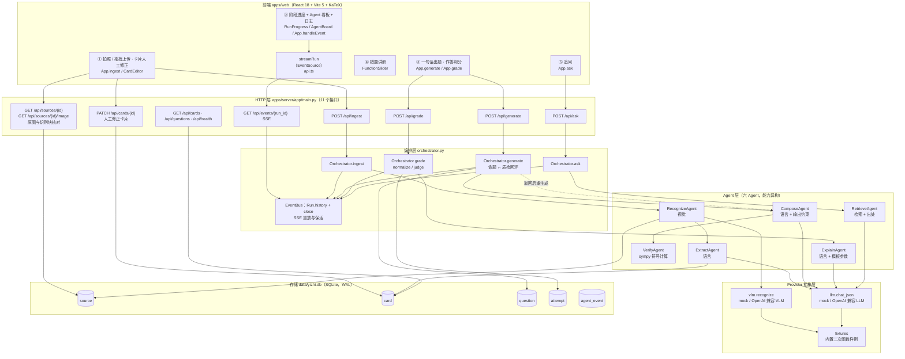
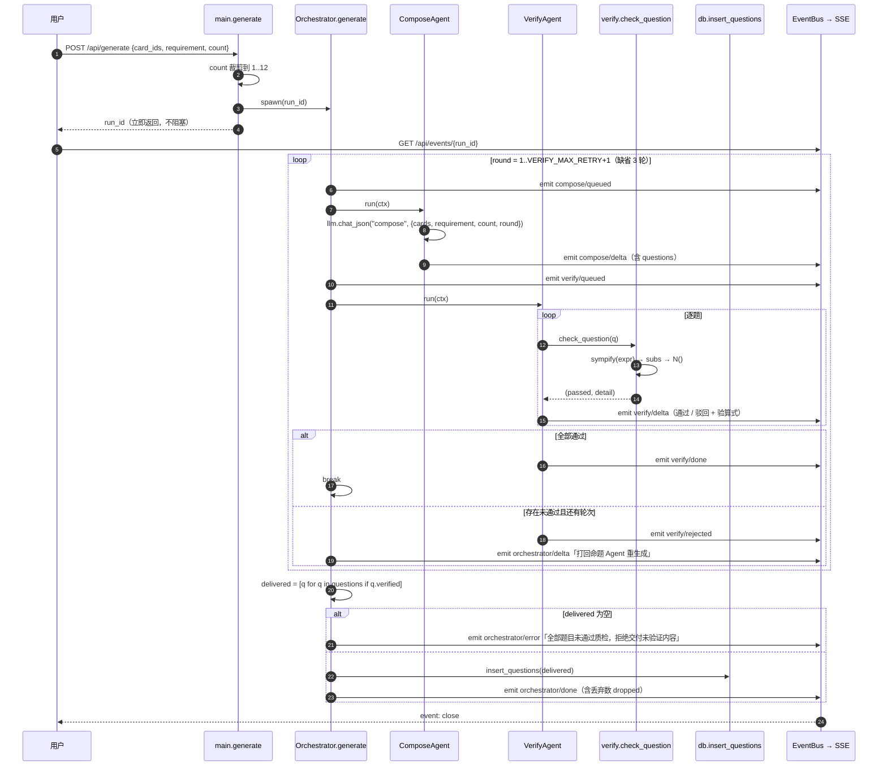

# 一纸成课（Paper2Lesson）· 技术文档

> 版本 v1.0 · 2026-11-15 · 提交版 PDF 由本文件导出，**总页数 ≤ 30**
>
> 阅读约定：
>
> - 所有实现结论都给出可核对位置，格式为 `文件:函数名` 或 `文件:常量名`，路径相对仓库根。
> - 页数为 A4、五号字、1.5 倍行距下的估算；mermaid 图、表格、代码块按实际占位另行计入。各章预估相加约 **28 页**，导出后若超 30 页，优先压缩第 4.4 节代码节选与附录 A 的字段表（两者信息密度最低）。
> - 文中「缺省」= 不配置任何环境变量时的行为。
> - 凡未实现的部分，一律在正文中直说，并在第 7 章汇总，不用「后续将」「正在规划」一类话掩盖。

| 项 | 内容 |
|---|---|
| 作品名 | 一纸成课（Paper2Lesson） |
| 形态 | 本地运行的 Web 应用（FastAPI + React），单机单用户；另有 Electron 外壳用于打包分发（`apps/desktop/`），Web 模式仍是主路径 |
| 代码规模 | 后端 18 个 Python 文件（6 个核心模块 + 6 个 Agent + 3 个 Provider，余为包初始化）+ 6 个测试文件；前端 9 个 TS/TSX 文件 + 1 份样式表 |
| 依赖 | 后端：FastAPI、httpx、sympy、SQLite（标准库）、pytest；前端：React、Vite、KaTeX |
| 测试 | `apps/server/tests/` 共 6 个文件、42 个用例，`pytest` 一条命令跑完 |
| 运行前提 | 无需任何 API Key：缺省 `mock` 提供方内置一套二次函数教学样例，全链路可跑通 |

---

## 1 作品概述

> 预估页数：2（约 800 字，含 2 表）

### 1.1 一句话定位

**拍下任何一页纸——板书、试卷、讲义、错题本——系统把它变成可追问、可练习、可讲解的交互式课程。**

这句话里三个动词对应三段能力，缺一段产品就不成立：

| 动词 | 含义 | 落地环节 |
|---|---|---|
| 可追问 | 对纸面内容提问，答案必须带出处 | 卡入库 + `RetrieveAgent` |
| 可练习 | 按需生成变式题，答案经过独立验算 | `ComposeAgent` + `VerifyAgent` |
| 可讲解 | 答错后指出错因，并能拖动参数看图形变化 | `ExplainAgent` + `FunctionSlider` |

### 1.2 目标用户与使用场景

| 用户 | 场景 | 现有做法 | 本作品的做法 |
|---|---|---|---|
| 理工科本科生 | 课后整理板书，考前想刷同类题 | 拍照存相册，考前翻图 | 上传一页 → 生成 5 道变式题 → 答错看讲解 |
| 高中生 | 错题本手抄，抄完不复习 | 手抄题干与解答 | 拍错题页 → 卡片化 → 追问「为什么这里要配方」 |
| 教师 / 助教 | 一份讲义要出随堂练习 | 手工改题号、改数字 | 一句话描述难度与题型，批量出题并逐题验算 |

这里不做用户调研数据的宣称：上述场景来自作者本人的学习过程与对现有工具的试用，样本量为 1；真实用户验证与可用性测试都没做，第 7 章 L13 会如实列出。

### 1.3 主界面

前端是单页两列栅格（左侧 320–400 px 窄栏，右侧主区），五个面板按使用顺序编号，代码位置 `apps/web/src/App.tsx:App`，栅格定义在 `apps/web/src/styles.css:.layout`：

| # | 区块 | 组件 / 关键函数 | 栅格位置 | 作用 |
|---|---|---|---|---|
| 1 | 拍一页纸 | `App.ingest`、`App.onDrop`、`components/CardEditor.tsx:CardEditor` | 左栏 | 拖入或拍照上传；卡片可点「编辑」就地修正并回写库 |
| 2 | Agent 协同看板 | `components/RunProgress.tsx:RunProgress`、`components/AgentBoard.tsx:AgentBoard` | 右栏 | 顶部阶段进度条（含已等待与 120 s 上限），下方六 Agent 状态卡与滚动日志 |
| 3 | 一句话出题 | `App.generate`、`App.grade` | 通栏 | 输入需求与题量，生成练习卷；逐题作答判分，显示「✓ 已验算 / ! 未验算」标签 |
| 4 | 错题讲解 | `components/FunctionSlider.tsx:FunctionSlider` | 左栏 | 答错后出现可拖动的二次函数图像与讲解文本 |
| 5 | 追问 | `App.ask` | 右栏 | 输入问题，回答下方列出引用卡片标题作为出处 |

看板不是装饰：第 3 章会说明它直接消费编排器发布的事件流，用户看到的「质检驳回 → 命题重生成」就是后端回环的真实投影。

### 1.4 演示入口

几步命令即可完整演示，无需密钥（详见 `README.md`）：

```bash
# 1) 后端
cd apps/server && pip install -r requirements.txt && \
  python -m uvicorn app.main:app --host 127.0.0.1 --port 8710
# 2) 前端（另开终端）
cd apps/web && npm install && npm run dev     # 打开 http://127.0.0.1:5173
# 3) 演示前重置数据（清空卡片/题目/上传图）
python apps/server/scripts/reset_demo.py
# 4) 自测（可选，42 个用例）
python -m pytest apps/server/tests -q
```

仓库另备三张演示样例图（`data/samples/`，由 `scripts/make_samples.py` 生成），现场可直接拖入，避免临时找材料。

`GET /api/health` 返回 `{"ok": true, "vlm_provider": "mock", "llm_provider": "mock"}` 即表示链路就绪（`apps/server/app/main.py:health`）。

### 1.5 交付物对照

| 提交物 | 要求 | 本仓库对应 |
|---|---|---|
| 代码仓库 | 公开、细粒度提交历史 | 独立仓库，按模块与 AI 会话提交（第 8 章） |
| AI 对话快照 | 必须提交 | `docs/ai-logs/`，每份含目标 / prompt / 输出摘要 / 判断 / 落地 |
| README | 照做能跑 | `README.md`，三步启动 + 配置表 + 边界声明 |
| 演示视频 | 5–8 min，含 AI 协同过程 | 与本文档分开提交 |
| 技术文档 | PDF ≤ 30 页 | 本文件 |

---

## 2 需求与痛点分析

> 预估页数：3（约 1200 字，含 3 表）

### 2.1 一条真实的学习链路，断在四个地方

把「拍下板书 → 真正学会」拆成可观测的步骤，断点一目了然：

| 步骤 | 用户动作 | 断点 | 后果 |
|---|---|---|---|
| S1 采集 | 手机拍板书 / 试卷 | 无（相机已足够好） | — |
| S2 结构化 | 想把公式、表格变成可编辑内容 | 需要公式识别，通用 OCR 不认公式 | 图片仍是图片 |
| S3 归档 | 想按知识点归类 | 手打标签成本高，且要判断「这一页讲了几个知识点」 | 相册里 1000 张图，复习时一张都找不到 |
| S4 练习 | 想找同类题练手 | 手上只有原题，没有变式；教辅不针对这一页 | 看完就忘 |
| S5 归因 | 做错了想知道错在哪 | 没有讲解，或讲解与自己的错法不对应 | 同一错误重复犯 |

现有工具集中在 S2，且多数停在 S2。**缺口不在识别，在识别之后**——这是本作品的选题依据，也是第 6 章「创新点」必须证明的东西：如果只是把 S2 做得更准，作品与 Mathpix 没有本质区别。

### 2.2 现有工具对比

对比维度按「学生真正需要什么」取，不按厂商宣传页取。「扫描类 App」指以扫描、去底、OCR 导出为主的一类移动应用，不针对具体产品；「本项目」列按当前实现（第 4 章）如实填写，未实现的一律标 —

| 维度 | Mathpix 类公式识别服务 | 扫描类 App | 本项目 |
|---|---|---|---|
| 主要输入 | 截图 / 图片 / PDF | 拍照 | 图片（png/jpg/webp/bmp，≤12 MB） |
| 主要输出 | LaTeX / Markdown / 可编辑公式 | 增强后的图片、PDF、可复制文本 | 知识点卡片 + 练习卷 + 讲解 |
| 公式 → LaTeX | ✅ 强项，准确率高 | ◐ 部分支持 | ◐ 由 VLM 一次生成，缺省 mock 不处理真实图片 |
| 版面切块（标题/正文/公式/表格） | ◐ 以行/块为主 | — | ✅ `type` 四类块，`providers/vlm.py:VLM_SYSTEM_PROMPT` |
| 知识点归档 | — | — | ✅ 一页 → 多张卡片，带 tags/subject |
| 按需生成变式题 | — | — | ✅ 自然语言需求 + 题量 |
| 答案独立验算 | — | — | ✅ sympy 代入验算，未通过打回重生成 |
| 错因讲解 / 可视化 | — | — | ◐ 一个二次函数滑块模板 |
| 带出处的追问 | — | — | ✅ 召回卡片原文并标出处 |
| 离线可用 | ❌ 依赖云服务 | ✅ | ✅ 缺省全 mock，零网络 |
| 数据归属 | 上传到厂商 | 本地为主 | 本地 SQLite + 本地图片目录 |
| 计费 | 按量订阅 | 订阅去广告 | 无（自建） |
| 可扩展性 | 输出即终点 | 输出即终点 | 数据在本地，可加题型/模板/学科 |

这张表要说清的只有一句：**从「知识点归档」这一行往下，两类现有工具基本全是空白，而空白处正好是「学会」真正发生的环节。**

### 2.3 为什么缺口长期存在

不是厂商没想到，而是三个结构性原因：

1. **识别是单步映射，教学是多步状态机。** 公式识别可以定义清楚「输入图像、输出 LaTeX」的损失函数；「这一页该切成几个知识点、每个知识点该配什么难度的题」没有唯一答案，需要生成式模型 + 约束 + 校验，工程形态完全不同。
2. **生成式输出天生不可信。** 一旦开始「出题」，就必须回答「答案对不对」。这要求系统内部存在一个能**否定**生成结果的环节（符号计算），而纯 OCR 产品没有这个需求，也就没有这套设施。本项目把它做成了架构主干（3.4、4.4）。
3. **工具边界与产品边界不一致。** 识别服务卖 API，扫描 App 卖存储空间，都不对「学生有没有学会」负责；要把 S2→S5 串起来，必须由一方持有全部数据，本地自建反而成本最低。

### 2.4 需求归纳

从断点反推，功能需求四条，非功能需求三条：

| 编号 | 类型 | 需求 | 验收方式（当前可验证） |
|---|---|---|---|
| F1 | 功能 | 上传一页纸，得到结构化版面块与知识点卡片 | `POST /api/ingest` 后 `GET /api/cards` 至少 1 张卡片 |
| F2 | 功能 | 一句话描述需求，生成指定数量的题 | `POST /api/generate`，`count` 生效且被裁剪到 1–12 |
| F3 | 功能 | 每道题必须经独立验算，未通过的不得静默交付 | `question.verified` + `verify_log` 写入数据库 |
| F4 | 功能 | 答错给出错因与可交互图形；追问须带出处 | `POST /api/grade` 返回 `explain`；`POST /api/ask` 返回 `citations` |
| N1 | 非功能 | 无密钥可完整演示，断网不崩 | 缺省 `mock`，`providers/fixtures.py` 提供全部样例 |
| N2 | 非功能 | 全过程可观测，用户能看见谁在跑、谁驳回了谁 | SSE 事件流 + 看板 |
| N3 | 非功能 | 真实模型只改配置不改代码 | `config.py` 环境变量 + Provider 抽象 |

N1 不是「降级方案」，而是刻意的主路径：比赛现场网络不可控，演示必须能在断网、无密钥、无 GPU 的机器上完整跑完（对应第 5 章降级设计）。

---

## 3 系统架构

> 预估页数：5（约 2200 字，含 2 张 mermaid 图 + 3 段代码 5 表）

### 3.1 总架构图

系统分五层，自下而上是存储、Provider 抽象、Agent、编排、HTTP/前端。Agent 之间不互相调用——所有跨 Agent 的数据传递都经由编排器持有的 `RunContext.state`，这是回环能实现的前提。



三点设计取舍需要说明：

| 取舍 | 选择 | 理由 |
|---|---|---|
| 不用 LangGraph | 自研 `asyncio` 状态机 | 三天窗口内，第三方框架的调试成本高于收益；回环只有「最多 3 轮」一种形态，几十行足够。接口保持 `Orchestrator.run` 语义，后续换适配器是加法 |
| SSE 不换 WebSocket | 单向推送用 SSE | 事件只从服务端流向浏览器；SSE 自带断线重连与事件 ID 语义，实现成本低于 WS |
| 不引入向量库 | SQLite + 字段加权匹配 | 卡片规模在演示阶段为个位数，向量库的部署与依赖成本换不来收益；缺什么在第 7 章写明 |

### 3.2 六个 Agent 的职责与能力异构

「多 Agent」常被质疑为「为了用而用」。回答这个问题的唯一方式是：**六个环节需要的不是同一个模型，而是不同的能力**，把它们塞进一个 prompt 必然互相干扰。

| # | Agent | 输入 | 输出 | 依赖能力 | 失败模式 | 代码 |
|---|---|---|---|---|---|---|
| A1 | 识别 | 图片路径 | `blocks[]`（title/text/formula/table） | 视觉语言模型 | 公式漏识别、表格结构塌陷 | `agents/recognize.py:RecognizeAgent.run` |
| A2 | 萃取 | `blocks[]` | `cards[]`（title/summary/subject/tags/formula/body） | 语言模型 + 切分判断 | 一张卡塞多个知识点 | `agents/extract.py:ExtractAgent.run` |
| A3 | 命题 | 卡片 + 自然语言需求 + 轮次 | `questions[]` 含 `verify` 三元组 | 语言模型 + 输出契约 | 答案算错、难度漂移 | `agents/compose.py:ComposeAgent.run` |
| A4 | 质检 | `questions[]` | `bool[]` + 逐题验算日志 | 符号计算（sympy） | 表达式不可解析 | `agents/verify.py:VerifyAgent.run` |
| A5 | 讲解 | 题目 + 用户答案 | 模板名 + 参数 + 讲解文本 | 语言模型 + 模板参数化 | 参数越界导致图空白 | `agents/explain.py:ExplainAgent.run` |
| A6 | 检索 | 查询串 | 答案 + 出处卡片 | 本地检索 + 语言模型 | 无命中时硬凑出处 | `agents/retrieve.py:RetrieveAgent.run` |

能力异构可以按「同一个错误，换个模型能不能自己发现」来判断：

- A3 用语言模型，A4 用符号计算。A3 算错了，A4 不知道 A3 在想什么，只拿到一个表达式与期望值，代入一算就知道对不对。**这种独立性是设计出来的，不是巧合。**
- A1 用视觉模型，A2 用语言模型。识别错了，A2 只能基于错误块往下走，所以 A1 的输出必须落库留档（`source.raw_json`），供人工核对。

六个 Agent 都不直接调用彼此。`agents/base.py:Agent.emit` 是唯一的对外动作——发事件；`RunContext.state` 是唯一的数据交换区。这条约束让「回环」在编排器里实现而不是在 Agent 里实现，Agent 本身保持无状态、可单测。

### 3.3 编排器与事件流

一次用户动作 = 一个 `run_id` = 一串事件。HTTP 层只做三件事：校验入参、创建 `Run`、把协程丢进后台（`main.py:spawn`）。

```python
# main.py:generate（节选）
count = max(config.QUESTION_MIN, min(config.QUESTION_MAX, req.count))
run_id = new_run_id()
bus.create(run_id)                     # 先建 Run，再 spawn
spawn(orchestrator.generate(run_id, req.card_ids, req.requirement, count))
return {"run_id": run_id}              # 立即返回，不阻塞
```

**先建 Run 再 spawn 的顺序很关键。** 前端拿到 `run_id` 才去订阅 SSE，中间存在几十毫秒的空窗；如果先启动任务后建 Run，早期事件会丢失。系统用「事件历史 + 游标重放」消除这个竞态：

```python
# events.py:EventBus.stream（节选）
sent = 0
while True:
    while sent < len(run.history):          # 迟到订阅者从头补齐
        yield run.history[sent].to_sse()
        sent += 1
    if run.closed:
        break
    run.changed.clear()
    try:
        await asyncio.wait_for(run.changed.wait(), timeout=KEEPALIVE_SECONDS)
    except asyncio.TimeoutError:
        yield ": keepalive\n\n"             # 15s 一次，防中间层断流
yield "event: close\ndata: {}\n\n"
```

事件模型与约束：

| 项 | 取值 | 位置 |
|---|---|---|
| 事件字段 | `run_id / agent / phase / message / payload / ts` | `events.py:Event` |
| phase 枚举 | `queued / running / delta / done / rejected / error` | `events.py:Event.phase` 注释 + `web/src/types.ts:Status` |
| 单次运行事件上限 | 500 条，超出丢弃但不阻塞 | `events.py:MAX_EVENTS_PER_RUN` |
| 保活间隔 | 15 s | `events.py:KEEPALIVE_SECONDS` |
| 传输格式 | `data: {json}\n\n`，JSON 不转义中文 | `events.py:Event.to_sse` |
| 结束信号 | `orchestrator` 的 `done`/`error` 事件；之后服务端补 `event: close` | `events.py:EventBus.stream`、`api.ts:streamRun` |
| 前端等待上限 | 120 s 后主动放弃，避免看板卡死 | `api.ts:RUN_TIMEOUT_MS` |
| 前端计时回调 | 每 1 s 上报已等待时长，驱动进度条 | `api.ts:PROGRESS_TICK_MS`、`onTick` |

前端把同一份事件流喂给三个消费者，各自的取用方式不同：

| 消费者 | 取用方式 | 目的 |
|---|---|---|
| `RunProgress` | 按 `STAGES` 把 Agent 映射成阶段，看阶段是否全 `done` | 一眼看出「卡在第几步」与已耗时 |
| `AgentBoard` | 每个 Agent 只保留最新一条事件，覆盖写 `board[agent]` | 六张卡片的实时状态 |
| 滚动日志 | 追加最近 200 条（`App.tsx:MAX_LOGS`） | 事后回看完整过程 |

阶段划分写在 `App.tsx:STAGES`，例如出题是三段「命题 → 质检验算 → 交付练习卷」。进度条不是假动画，而是**由真实事件推导**：只要 `verify` 还是 `running`，进度就停在第二段。

结束原因被显式分成四种（`api.ts:StreamReason`），因为四种情况的用户动作完全不同：

| reason | 触发条件 | 界面表现 |
|---|---|---|
| `done` | 收到 `orchestrator/done` | 正常渲染结果 |
| `error` | 收到 `orchestrator/error` | 错误横幅写明「哪个 Agent 阶段」，可重试 |
| `timeout` | 超过 120 s 无结束事件 | 提示「已停止等待，可重试」，不是静默转圈 |
| `broken` | 事件流提前关闭且未见过结束事件 | 区分「一条事件都没收到」与「收到 N 条后断流」 |

`broken` 单独成一类值得说明：服务端在 `done` 之后会补一条 `close`，正常情况下前端在 `done` 时已经 resolve，走不到 `broken`；一旦走到，说明连接真的断了，此时界面提示「结果可能不完整，可重试」——比伪装成功诚实。

`phase=rejected` 在看板上是独立的橙红色态（`styles.css:.agent-rejected`），并配 `✕` 符号（`AgentBoard.tsx:PHASE_MARK`），色觉异常或投影褪色时仍能靠形状区分。这样「质检驳回了命题」不会与「运行失败」混淆。

编排器自身的四个方法都遵循同一骨架：`try / except / finally`，`finally` 里必定 `bus.close(run_id)`——**任何异常路径都不能让 SSE 悬挂**。异常不抛出到 HTTP 层（响应早已返回），统一转成 `orchestrator/error` 事件由前端显示（`orchestrator.py:Orchestrator._fail`）。

### 3.4 命题 ↔ 质检回环

这是整个作品的胜负手：一个 prompt 不能否定自己，两个能力不同的 Agent 可以。



对应实现只有二十行，核心是「只有全部通过才 break」：

```python
# orchestrator.py:Orchestrator.generate（节选）
max_rounds = config.VERIFY_MAX_RETRY + 1          # 缺省 3
for round_no in range(1, max_rounds + 1):
    ctx.state["round"] = round_no                  # 轮次传给命题 Agent
    await self._step(ctx, ComposeAgent)
    results = await self._step(ctx, VerifyAgent)
    if results and all(results):
        break
    if round_no < max_rounds:
        await self._emit(run_id, "orchestrator", "delta",
                         f"第 {round_no} 轮有题未通过，打回命题 Agent 重生成")

questions = ctx.state.get("questions", [])
delivered = [q for q in questions if q.get("verified")]
dropped = len(questions) - len(delivered)
if not delivered:
    raise RuntimeError("全部题目未通过质检，拒绝交付未验证内容")
```

四个行为约定必须写清楚，否则容易被误解为「有 bug」：

| 约定 | 行为 | 依据 |
|---|---|---|
| 有限重试 | 最多 3 轮（`VERIFY_MAX_RETRY=2` 再加首轮），不做无限重试 | 防止坏 prompt 或坏模型无限循环拖死请求 |
| 部分通过即交付 | 循环结束（全过或轮次用尽）后，只交付 `verified` 为真的题，其余丢弃并在 `done` 消息里报数 | 学生要的是能做的题，不是全有或全无 |
| 全废则报错 | 全部未通过时抛 `RuntimeError`，前端显示错误，不入库 | 「宁可不出题，也不交付未验证内容」 |
| 轮次可见 | 命题 Agent 的 `running` 消息里带「第 N 轮」，看板与日志都能看到 | 让回环成为可观测事实，而不是文档里的说法 |

`round` 参与 prompt payload（`agents/compose.py:ComposeAgent.run` 里 `"round": round_no`），这不是装饰：真实模型收到「上一轮被打回、请重新出题」的上下文后会改变采样结果；mock 提供方则用轮次直接切换样例（`providers/fixtures.py:mock_questions`，`round_no==1` 时刻意留一道期望值写错的题），保证演示必然出现一次驳回。

### 3.5 一次 generate 运行的事件序列

把「一句话出题」拆成事件看，用户在看板上看到的东西是这样一条时间线（缺省 mock、5 道题、第 1 轮有 1 题不过）：

| # | agent | phase | message（节选） | 看板表现 |
|---|---|---|---|---|
| 1–4 | `compose` | `queued`→`running`→`delta`→`done` | 「按需求命题（第 1 轮）：给我出 5 道…」→「生成 5 道题，待质检」 | 命题卡由灰蓝转亮再转完成色 |
| 5–6 | `verify` | `queued`→`running` | 「逐题验算 5 道题」 | 质检卡亮起 |
| 7–11 | `verify` | `delta` | 「求…对称轴。」通过：`x**2-4*x+3 @ {'x': 2} = -1，期望 -1` | 逐条打印验算式 |
| 12–13 | `verify`→`orchestrator` | `rejected` / `delta` | 1 道题未通过验算，打回命题 Agent 重生成 | 质检卡转驳回色（橙红 + `✕`），进度条停在第二段 |
| 14–22 | `compose`→`verify` | 同上 | 第 2 轮全部通过 | 状态重走一遍 |
| 23–24 | `verify`→`orchestrator` | `done` | 「5 道题全部通过验算」→「交付 5 道题」 | 进度条走满，练习卷渲染 |

两处细节值得注意：

- **驳回与失败是两种颜色。** `rejected` 由业务判定产生（题不好），`error` 由异常产生（系统坏了）。混成一个颜色会让观众以为演示出故障。
- **验算式直接进 `message`。** 第 7–11 条不是「第 1 题通过」这种结论，而是「表达式 @ 代入值 = 计算值，期望 期望值」的完整账单。结论可以伪造，账单不能。

---

## 4 关键实现

> 预估页数：6（约 3600 字，含 9 段代码 / JSON 片段 6 表；代码与片段按 9 pt 排版）

### 4.1 版面识别与结构化

识别环节的目标不是「拿到一段文字」，而是「拿到机器能继续处理的块」。这一点决定了输出的形状：

```json
{"blocks": [
  {"type": "title",   "content": "二次函数的图象与性质", "latex": ""},
  {"type": "formula", "content": "y = ax^2 + bx + c",
   "latex": "y = ax^2 + bx + c \\quad (a \\neq 0)"},
  {"type": "table",   "content": "a>0 开口向上 / a<0 开口向下；…"}
]}
```

四类块 `title / text / formula / table` 的划分依据是「下游用法不同」：`formula` 的 `latex` 字段会被前端直接交给 KaTeX（`web/src/components/MathText.tsx`），`table` 折成单行文字是为了避免二维结构在 LLM 上下文里被压扁成无意义的行列；`title` 用于切分知识点，`text` 是兜底。

提示词里写进了三条硬约束（`providers/vlm.py:VLM_SYSTEM_PROMPT`）：

| 约束 | 原文 | 解决什么 |
|---|---|---|
| 公式必须给 LaTeX | 「数学公式放 formula 块并给出 latex」 | 避免 KaTeX 渲染失败 |
| 表格压成单行 | 「表格压成单行文字放 table 块」 | 二维表格在 token 化后行列错位 |
| 不许猜 | 「看不清的内容写 `[无法识别]`，不要猜」 | 幻觉比缺失更危险：缺失用户能补，编造用户看不出 |

Provider 抽象只有一层，切换成本一行配置：

```python
# providers/vlm.py:recognize
async def recognize(image_path: Path) -> list[dict[str, Any]]:
    if config.VLM_PROVIDER == "mock":
        return [dict(block) for block in fixtures.MOCK_BLOCKS]
    return await _remote(image_path)
```

`_remote` 走 OpenAI 兼容协议：图片 base64 编码为 `data:{mime};base64,...`，`temperature=0.0`（识别不需要创造性），`response_format={"type":"json_object"}` 要求结构化输出，超时 120 s（`providers/vlm.py:REQUEST_TIMEOUT`）。未配置时不是静默回退到 mock，而是**一次性列出缺哪几项**并抛 `RuntimeError`（`providers/vlm.py:_remote`）——静默回退会让人误以为在跑真实模型，这是比崩溃更坏的失败。提示语里还写明「qwen / glm 会自动补地址与视觉模型，通常只需给 Key」，因为多数时候用户只是没填 Key，不必再去查端点地址。

模型输出不保证是合法 JSON（会裹上 json 代码栅栏、会加一句「好的，以下是结果」）。`providers/vlm.py:_loads` 做两级兜底：先 `json.loads`，失败则用 `\{.*\}` 贪婪正则截取最外层对象再解析，仍失败才抛错并只回显前 200 字符。同样的逻辑在 `providers/llm.py:_loads` 复制了一份——这是有意为之：两个 Provider 的失败模式不同（VLM 更容易夹带解释文字），但容错策略一致，复制比抽象更不容易在三天里出错。

上传链路有三道闸门，全部在 HTTP 层，进不了业务逻辑（`main.py:ingest`）：

| 闸门 | 规则 | 理由 |
|---|---|---|
| 后缀白名单 | `.png/.jpg/.jpeg/.webp/.bmp`（`config.ALLOWED_SUFFIXES`） | 视觉模型的输入格式有限；白名单比黑名单可维护 |
| 体积上限 | 12 MB（`config.MAX_UPLOAD_BYTES`） | 手机直出照片通常 2–5 MB；超过多半是扫描件误传 |
| 落盘命名 | `uuid4().hex + 原后缀` | 避免同名覆盖，也避免把用户文件名（可能含个人信息）写进库 |

图片落盘后只把路径传给识别 Agent，Agent 内部再读字节转 base64。这样做的代价是多一次磁盘读，收益是识别可以异步重跑——原图始终在，重跑不必让用户再传一次。

「原图始终在」还支撑了核对入口：`GET /api/sources/{id}` 返回原始块与该来源下的卡片（`db.get_source` 把 `raw_json` 解析回 `blocks`，`db.get_cards_by_source` 按 `source_id` 取卡片），`GET /api/sources/{id}/image` 以 `FileResponse` 回原图并按后缀给 MIME（`main.py:source_image`）。两个接口合起来就能实现「原图与识别结果并排」，用户自己判断是漏了公式还是切错了知识点。文件已被清理时返回 404 而不是 500。

### 4.2 知识点萃取与卡片模型

萃取是「从版面块到可检索单元」的一步，输出是一张张结构化的卡片：

```python
# providers/llm.py:SYSTEM_PROMPTS["extract"]
'{"cards": [{"title": str, "summary": str, "subject": str,
             "tags": [str], "formula": str, "body": str}]}'
# 要求：每张卡片只讲一个知识点，formula 用 LaTeX，body 保留原文细节。
```

六个字段各有下游用途，不是随手加的：

| 字段 | 用途 | 谁在用 |
|---|---|---|
| `title` | 卡片标题，检索加权最高 | `db.search_cards` 标题权重 2.0 × token 权重 |
| `summary` | 一句话摘要，追问回答的默认素材 | `providers/llm.py:_mock` 的 `body or summary` 兜底 |
| `subject` | 学科，原本留给多学科筛选 | 已入库但暂未参与检索与筛选 |
| `tags` | 标签，检索次高权重 1.5 | `db.search_cards` |
| `formula` | 该知识点的主公式，前端单独渲染 | `App.tsx` 卡片区 `MathText` |
| `body` | 原文细节，追问时作为引用正文 | `RetrieveAgent` 的 `cards[]`（对外只带 title/summary）与 mock 回答正文 |

`body` 与 `summary` 分开存是刻意的：摘要适合放进 prompt 上下文，正文适合作为「出处」展示给人看。同一份数据两种粒度，避免为了省 token 而让人看不到原文。

入库由 `db.insert_cards` 完成，`tags` 列表用逗号拼成字符串（`",".join`）——这是 SQLite 单表存储的常见折中，代价是标签不能单独索引，第 7 章列为改进项。卡片 ID 回填到内存对象（`agents/extract.py:ExtractAgent.run` 里 `card["id"] = card_id`），因为后续命题需要把卡片 ID 写进题目的 `card_ids` 字段，形成「这道题考的是哪几张卡」的可追溯链条。

`source` 表保存原始块（`raw_json`），与卡片是 1:N 关系。这样做的目的是可核对：当用户觉得「这张卡总结得不对」，可以回看模型到底看到了什么块。

萃取结果允许人工修正，这条链路是完整闭环的：

| 步 | 动作 | 位置 |
|---|---|---|
| 1 | 卡片上点「编辑」，进入表单（标题 / 摘要 / 公式 / 正文） | `App.tsx` 的 `editingId`、`components/CardEditor.tsx` |
| 2 | 只提交**真正改过**的字段 | `CardEditor.tsx:diffDraft` |
| 3 | `PATCH /api/cards/{id}`，后端按白名单局部更新 | `main.py:patch_card`、`db.py:update_card` |
| 4 | 返回更新后的完整卡片，前端就地替换列表项 | `CardEditor.tsx` 的 `onSaved` → `App.handleCardSaved` |

两个细节是刻意的：

- **字段白名单只放四个**（`db.py:CARD_PATCH_FIELDS` = `title/summary/formula/body`）。`source_id`、`created_at` 是归属与时间，改了会破坏「这张卡从哪来」的追溯链；`subject`、`tags` 属于分类体系，应由另一套流程管。
- **只提交差异**。打开表单又没改，`diffDraft` 返回空对象，前端直接关闭（连请求都不发）；真发了空 `PATCH`，后端也返回原卡片而不是报错（`test_patch_empty_body_keeps_card` 固定了这一行为）。404 则分两种含义提示：卡片真的没了，或后端还没挂上这条路由。

标题为空在前端就拦下（`CardEditor.tsx:TITLE_MAX_CHARS`），因为空标题会污染检索权重（标题权重最高，见 4.5）。

**这里有一处遗留缺口，写在第 7 章不藏**：修正没有留痕。卡片表没有 `corrected_by_user` 字段，前端的「已人工修正」标签只存在会话内（`App.editedIds`），刷新即消失——「谁在什么时候改了什么」目前查不到，原值也没备份。

### 4.3 命题约束与 LaTeX 输出

命题是被约束得最紧的一环。约束写在提示词里，但真正的强制执行发生在代码里。

提示词的输出契约要求七项字段，其中 `verify` 是全部创新点的落点：

```python
# providers/llm.py:SYSTEM_PROMPTS["compose"]
'{"questions": [{"stem_latex": str, "qtype": "fill"|"choice",
                 "options": [str], "answer": str, "solution": str,
                 "difficulty": "easy"|"medium"|"hard",
                 "verify": {"expr": "sympy 可解析的表达式",
                            "subs": {"x": 数值}, "expect": 数值}}]}'
# 要求：题干数学内容用 LaTeX（$...$）；verify 必须给出可用代入数值的校验式。
```

`verify` 三元组的设计是本文档最需要解释的一处：

| 字段 | 含义 | 例（顶点题） |
|---|---|---|
| `expr` | 可被 sympy 解析的表达式 | `x**2 - 4*x + 3` |
| `subs` | 变量代入值 | `{"x": 2}` |
| `expect` | 代入后应有的数值结果 | `-1.0` |

它把「这道题的答案对不对」转成「一个数值等式是否成立」。这不是让模型自评（自评不可信），而是让模型**提交一份可被独立核算的账单**：模型说答案是 -1，那就把 -1 写成 `expect`，验算方只做代入。四类题都能这么表达：

| 题型 | `expr` 写法 | 说明 |
|---|---|---|
| 求函数值 | `x**2 - 4*x + 3`，`subs={"x":2}`，`expect=-1` | 直接代入 |
| 交点个数 | `(-4)**2 - 4*1*3`，`subs={}`，`expect=4` | 判别式本身即表达式 |
| 化为顶点式 | `(x-2)**2 - 1 - (x**2-4*x+3)`，`subs={"x":5}`，`expect=0` | 两式之差恒为 0，任取一点代入 |
| 对称轴 | `-(-4)/(2*1)`，`subs={}`，`expect=2` | 先把 $a,b$ 代成具体数，避免符号变量未赋值 |

代码侧的强制约束有两条：

1. **题量裁剪**：`questions = (result.get("questions") or [])[:count]`（`agents/compose.py:ComposeAgent.run`）。模型多给不要，少给不补——补题只能靠再生成，不能靠复制。
2. **卡片溯源回填**：`question.setdefault("card_ids", card_ids)`。模型没写来源就默认挂到本次使用的全部卡片上，保证每道题都能回答「这题从哪来」。

为什么题干用 `$...$` 包裹而不是整段 LaTeX？因为题干要混排中文与公式（「求 $y=x^2-4x+3$ 的对称轴」），行内公式是唯一能自然嵌入中文句子的写法，且前端渲染器只需按 `$` 切分（`MathText.tsx` 的 `split(/(\$[^$]*\$)/g)`）。

### 4.4 质检的双路验算

质检 Agent 是全文最短的一个文件（70 行），却是整个架构的支点。

```python
# agents/verify.py:check_question
def check_question(question: dict) -> tuple[bool, str]:
    verify = question.get("verify")
    if not verify:
        return True, "无可验算表达式，仅做结构检查"

    expr_text = str(verify.get("expr", "")).strip()
    try:
        expr = sp.sympify(expr_text)
        raw_subs = verify.get("subs") or {}
        subs = {sp.Symbol(name): sp.nsimplify(value) for name, value in raw_subs.items()}
        value = float(sp.N(expr.subs(subs)))
    except Exception as exc:            # 表达式不可解析即视为不通过
        return False, f"表达式无法解析：{exc}"

    expect = float(verify.get("expect", 0.0))
    passed = abs(value - expect) <= TOLERANCE
    detail = f"{expr_text} @ {raw_subs or '(无代入)'} = {value:g}，期望 {expect:g}"
    return passed, detail
```

逐点说明工程考虑：

| 处理 | 为什么这么写 |
|---|---|
| `sp.sympify` 而非 `eval` | 不接受任意 Python 代码，只解析数学表达式；沙箱性来自语言子集本身 |
| `sp.nsimplify` + `sp.N` + `float()` | 先转有理数减少浮点误差，再数值化比较，避免 `sqrt(2)` 与 `1.414` 的符号比较失败 |
| `TOLERANCE = 1e-6` | 浮点累积误差远小于此，而真实错误（正负号、漏项）远大于此 |
| 异常即不通过 | 解析失败意味着这份「账单」不可核算，不能当通过 |
| `detail` 落库 | 验算过程写进 `question.verify_log`，界面上可展开查看 |

一条真实的驳回记录（mock 第 1 轮第 4 题，可直接复现）：

| 项 | 值 |
|---|---|
| 题干 | 若 $y = x^{2} - 4x + 3$ 在 $x = 2$ 处的函数值为 $m$，则 $m$ 等于？ |
| 声称答案 | `-1` |
| 提交的账单 | `expr = x**2 - 4*x + 3`，`subs = {"x": 2}`，`expect = 1.0` |
| 实际计算 | $2^2 - 4 \times 2 + 3 = -1$，`value = -1.0` |
| 判定 | `abs(-1.0 - 1.0) = 2.0 > 1e-6` → **驳回** |
| 落库文本 | `x**2 - 4*x + 3 @ {'x': 2} = -1，期望 1` |

这道题的错误不在题干，也不在 `expr`，而在模型把 `expect` 写成了正数。**这类「答案文本对了、自检账单错了」的错误，用文本比对永远发现不了，只有代入验算能抓到。** 它就是演示时看板上那条橙红色驳回的真实来源。

「双路」指两种判定，但当前实现是不对称的，必须说清：

| 路径 | 实现状态 | 说明 |
|---|---|---|
| 符号代入验算 | ✅ 已实现 | `check_question` 主体，覆盖所有带 `verify` 的题 |
| 无表达式时的结构检查 | ❌ 未实现 | 代码直接返回 `True` 并给出说明文字；`detail` 里的「仅做结构检查」目前只是命名，没有实际检查逻辑 |
| LLM 复核 | ❌ 未实现 | 设计目标是「sympy 验算 + LLM 复核」，实际只落地了前半 |

这一点在界面上的表现是诚实但不完美的：没有 `verify` 的题会被标成 `已验算`（因为 `verified=True`），而不是「未验算」。第 7 章把「拆成 `verified_symbolic` / `verified_structural` / `unverified` 三级」列为第一优先改进项。真正的「未验算」态在代码里存在（`verified=false` → `tag-warn`），但验算失败的题会在交付阶段被丢弃，所以这个标签只在极端情况下可见。

判分是同一套思路的简化版：

```python
# orchestrator.py:normalize / judge
def normalize(text: str) -> str:
    text = str(text).translate(FULLWIDTH_TABLE)      # 全角标点 → 半角
    return re.sub(r"[\s$\\({})\\\\]", "", text).lower()

def judge(question: dict, user_answer: str) -> bool:
    expected = normalize(question.get("answer", ""))
    given = normalize(user_answer)
    if question.get("qtype") == "choice":
        return bool(given) and bool(expected) and given[0] == expected[0]
    return given == expected
```

`normalize` 先做全角转半角（`FULLWIDTH_TABLE`：`（）`→`()`、`，`→`,`、`：`→`:` 等），再去掉空白、`$`、括号、反斜杠并转小写；选择题只比首字符，因为前端提交的是字母（`App.tsx:LETTERS`）。

全角映射这一步不是可有可无的礼貌处理：中文输入法下学生打「（2，-1）」的概率极高，不映射就会与标准答案「(2,-1)」判错。特别注意**全角逗号是映射而不是删除**——如果图省事把它一起删掉，`(1,2)` 会退化成 `(12)`，两个不同坐标被判同（`tests/test_judge.py` 里专门为此写了一条断言）。

这条规则能吃掉记号差异（`$x=2$` / `x = 2` / `X=2` / `（2，-1）` 都能判同），但吃不掉语义差异：`x=2` 与 `2=x` 判错，`-1` 与 `−1`（Unicode 减号 U+2212）判错，多答案（`-1, 3`）不支持，代数等价式（`(x-2)^2-1` 与 `x^2-4x+3`）也判不同。第 7 章给出基于 sympy 的等价判分改进方案。

### 4.5 检索与出处标注

检索目标不是「找得全」，而是「答得住，且能指出依据」。当前实现是一个零依赖的字段加权匹配器：

```python
# db.py:_query_tokens
def _query_tokens(query: str) -> list[str]:
    compact = re.sub(PUNCTUATION, "", query)
    if not compact:
        return []
    tokens: set[str] = {compact[i : i + 2] for i in range(len(compact) - 1)}
    if len(compact) <= WHOLE_QUERY_MAX_CHARS:
        tokens.add(compact)
    tokens.update(w for w in query.split() if w.isascii())
    return [t for t in tokens if t]
```

中文没有空格，整句匹配在「为什么这里要配方」这类问法上必然命中 0（这正是开发中真实踩到的坑，第 8 章记录）。2-gram 切分把「配方」切成「为什/什么/么这/这里/里要/要配/配方」，只要卡片正文里有「配方」就能命中。评分规则：

| 命中字段 | 权重（相对） | 依据 |
|---|---|---|
| `title` | 2.0 | 标题是知识点名，命中标题通常就是要找的卡 |
| `tags` | 1.5 | 人工/模型打的结构化标签 |
| `summary` | 1.0 | 摘要 |
| `body` | 1.0 | 正文，长文本容易偶然命中，不给高权重 |

token 长度 ≥ 4 时权重 ×3（`db.py:search_cards` 里的 `weight` 分支），因为长 token 更具体。低于 `MIN_SCORE = 2.0` 的候选被丢弃——**这一条是为了避免硬凑出处**：没有可信命中就返回空，让下游说「材料中未涉及」。

检索结果的消费在 `agents/retrieve.py:RetrieveAgent.run`：`top_k` 固定为 `RAG_TOP_K = 3` 不暴露给前端；回答强制带卡片列表（模型没给 `citations` 时用召回卡片 ID 兜底）；回答文本与出处分离返回，空召回时前端显示「无匹配材料」。

提示词里有一条硬约束：「卡片里没有的内容必须说明『材料中未涉及』，不得编造」（`providers/llm.py:SYSTEM_PROMPTS["answer"]`）。mock 实现直接照此执行：无召回时返回固定句（`providers/llm.py:_mock` 的 `answer` 分支），这句在演示中可复现。

**必须承认的差距**：设计目标是「FTS5 + 向量混合检索」，实际是内存全表扫描 + 子串计分。这是规模判断——当前卡片是两位数，建索引与加载 embedding 的时间成本在三天窗口里换不到收益。代价很清楚：同义改写（「配方法」vs「配方」）召回不到，跨语言几乎无效。第 7 章给出替换路径。

### 4.6 可视化讲解模板与参数化

讲解 Agent 的输出是一个「可执行的教学动作」，而不是一段话：

```json
{"template": "function_slider",
 "title": "拖动 a 看开口怎么变",
 "params": {"a": 1.0, "b": -4.0, "c": 3.0, "x_min": -1.0, "x_max": 5.0},
 "script": "你把函数值算成了正数，问题出在代入顺序：…"}
```

`params` 的五个数值直接决定图形，`script` 是配套解说，`title` 是图上方的一句话。前端只做一件事：把参数变成可交互的 SVG。

```typescript
// components/FunctionSlider.tsx:buildPath（节选）
for (let i = 0; i <= STEPS; i++) {                 // STEPS = 180
  const x = xMin + ((xMax - xMin) * i) / STEPS;
  const y = a * x * x + b * x + c;
  if (y < -Y_LIMIT || y > Y_LIMIT) { drawing = false; continue; }  // 出界断笔
  const px = PADDING + ((x - xMin) / (xMax - xMin)) * (WIDTH - PADDING * 2);
  const py = PADDING + ((Y_LIMIT - y) / (2 * Y_LIMIT)) * (HEIGHT - PADDING * 2);
  commands.push(`${drawing ? "L" : "M"}${px.toFixed(1)},${py.toFixed(1)}`);
  drawing = true;
}
```

四个参数化决策：

| 决策 | 取值 | 理由 |
|---|---|---|
| 采样点数 | 180 | 420 px 宽的图上每 2 px 一个点，肉眼无折线感 |
| 纵轴固定范围 | `Y_LIMIT = 8` | 拖动滑块时坐标系不跳，否则「a 变大」的视觉变化会被自动缩放抵消，讲解失效 |
| 出界处理 | 断开路径（`drawing = false`） | 抛物线陡峭时直接出框，而不是把坐标系压缩到失真 |
| 只让 `a` 可拖 | `b, c, x_min, x_max` 固定 | 一个模板讲一个概念；四个滑块会让「a 影响什么」失焦 |

顶点标记按需显示：`a === 0` 不是二次函数，或顶点落在视窗外时，虚线与圆点都不画（`vertexVisible` 判断）。这样避免了「退化直线也标个顶点」的荒谬画面。

**模板路由未实现**：前端 `FunctionSlider` 不检查 `explain.template` 字段，收到任何 `explain` 都渲染滑块图。`template` 目前只是留给未来的扩展位，第 7 章列为改进项。这也是「只做一个模板」决策的代价——省下了实现时间，留下了语义空洞。

参数缺失与退化输入没有被系统处理：`params` 缺 `x_min`/`x_max` 或两者相等时路径失效（图区空白），`a = 100` 时曲线全部出框，只有 `a === 0` 被显式处理（`vertexVisible` 判断）。当前写法「相信上游给全参数」，在 mock 下没问题、在真实模型下有风险（第 7 章 L7）。补法是给 `params` 加一层 schema 校验与默认值，与 `config.py` 的「缺字段按默认值补」保持同一原则。

---

## 5 工程与质量

> 预估页数：3（约 2300 字，含 6 表；表格密排）

### 5.1 配置开关与降级路径

所有可变项集中在 `apps/server/app/config.py`，从环境变量读取，缺字段按默认值补（`os.environ.get(key, default)`），未知字段忽略——旧配置原样能跑。

| 变量 | 缺省 | 作用 | 改动影响 |
|---|---|---|---|
| `VLM_PROVIDER` | `mock` | 视觉识别提供方（`mock`/`qwen`/`glm`） | 切真实模型只改这一行 + 给 Key |
| `LLM_PROVIDER` | `mock` | 语言模型提供方（`mock`/`deepseek`/`qwen`） | 同上 |
| `VLM_API_KEY` / `LLM_API_KEY` | 空 | 密钥，唯一必须人工填的项 | 空则非 mock 提供方直接报错 |
| `VLM_BASE_URL` / `VLM_MODEL` | 空（按 provider 预设自动补） | 端点与模型名 | 显式设置可覆盖预设 |
| `LLM_BASE_URL` / `LLM_MODEL` | 空（同上） | 同上 | 同上 |
| `VERIFY_MAX_RETRY` | `2` | 质检回环最大重试次数 | 0 = 只出一轮，不重生成 |
| `APP_HOST` / `APP_PORT` | `127.0.0.1` / `8710` | 监听地址与端口 | 与 `vite.config.ts` 代理目标一致 |
| `CORS_ORIGINS` | 本地两源 | 允许跨源来源，逗号分隔 | 换端口需同步 |
| `QUESTION_MIN`/`QUESTION_MAX`/`DEFAULT_QUESTION_COUNT` | 1 / 12 / 5 | 题量硬边界 | 常量，非环境变量 |
| `RAG_TOP_K` | 3 | 检索召回条数 | 常量 |

Provider 的端点与模型名不再要求用户填写，而是内置一张按名字索引的预设表（`config.py:PROVIDER_PRESETS`），解析顺序固定为三级：

```python
# config.py:resolve_provider_value
explicit = (env.get(env_key) or "").strip()   # 1 显式环境变量
if explicit:
    return explicit
return provider_presets(provider).get(preset_key, "")   # 2 provider 预设；3 空串
```

三组预设覆盖三家云厂商：`qwen` / `glm` 同时提供视觉与文本模型，`deepseek` 仅文本；`mock` 与未知名字返回空字典（由调用方决定如何报错）。

这条设计有两处值得记：`deepseek` 只配文本模型，是因为它不提供视觉能力，硬补一个「看起来合理」的视觉模型名会让错误延后到第一次请求才暴露；预设表里**不含任何密钥字段**，并有测试逐项断言（`tests/test_config.py:test_presets_carry_no_secret`），把「密钥不进代码」从口头约定变成可执行检查。

降级路径共六条，都是「不让演示中断」这一目标的具体化：

| 触发条件 | 系统行为 | 位置 |
|---|---|---|
| 无密钥 / 无网络 | 全程 mock，内置样例走完整链路 | `providers/fixtures.py` |
| 模型返回非 JSON | 正则截取最外层对象重试解析，失败才报错 | `providers/*.py:_loads` |
| KaTeX 语法错误 | `throwOnError: false` + try/catch，退化为原文显示 | `web/src/components/MathText.tsx` |
| SSE 长时间无事件 | 15 s 一次 `: keepalive`；前端 120 s 超时放弃 | `events.py:KEEPALIVE_SECONDS`、`api.ts:RUN_TIMEOUT_MS` |
| SSE 提前断流 | 返回 `reason: "broken"`，界面提示结果可能不完整并可重试 | `api.ts:streamRun` |
| 任一 Agent 抛异常 | 转 `orchestrator/error` 事件，`finally` 关闭 Run，不悬挂连接 | `orchestrator.py:_fail` |

配置原则可以压成一句：**缺省即最稳路径，开关只做加法**。默认走 mock 不是省事，而是让「没有 API Key 的评审环境」也能在 3 分钟内跑通全流程；真实模型是可选增强，不是运行前提。

### 5.2 目录结构

```
yizhi-chengke/
├─ apps/
│  ├─ server/
│  │  ├─ app/
│  │  │  ├─ main.py            # HTTP 入口：11 个接口 + CORS + lifespan
│  │  │  ├─ orchestrator.py    # 编排：ingest / generate（回环）/ grade / ask + 判分归一化
│  │  │  ├─ events.py          # 事件模型、Run、EventBus、SSE 生成器
│  │  │  ├─ db.py              # 建表、写入与局部更新、来源查询、检索评分
│  │  │  ├─ config.py          # 环境变量、provider 预设、上传与题量约束
│  │  │  ├─ agents/            # base + 六个 Agent，一对一文件
│  │  │  └─ providers/         # vlm / llm / fixtures
│  │  ├─ tests/                # 6 个测试文件、42 个用例（conftest 隔离临时库）
│  │  ├─ pytest.ini            # 关掉 pytest 缓存，避免仓库里落临时目录
│  │  ├─ scripts/reset_demo.py # 演示前清库
│  │  └─ requirements.txt      # 5 个直接依赖，版本钉死
│  ├─ web/
│  │  ├─ src/                  # App.tsx、api.ts、types.ts、main.tsx + 5 个组件
│  │  └─ dist/                 # 预构建产物（可直接静态托管演示）
│  └─ desktop/                 # Electron 外壳：拉起内置 Python 后端并加载 dist（打包分发用）
├─ data/                       # 运行数据：yizhi.db + uploads/ + samples/（不入库）
├─ scripts/make_samples.py     # 生成三张演示样例图
├─ docs/
│  ├─ 技术文档.md               # 本文件
│  └─ ai-logs/                 # AI 会话快照 + 索引
└─ README.md
```

分层与文件的对应关系是刻意的：一个 Agent 一个文件（最长 70 行）、一个 Provider 一个文件，改动定位快——「质检太严」只需看 `agents/verify.py`，「召回不准」只需看 `db.py:search_cards`。

测试与源码平级放 `apps/server/tests/`，`conftest.py` 用 `monkeypatch` 把 `DB_PATH`、`DATA_DIR`、`UPLOAD_DIR` 全部指向 `tmp_path`，并强制两个 Provider 为 `mock`——**跑测试永远不会碰 `data/yizhi.db`，也不会因为环境里配了真实 Key 而走网络。**

### 5.3 错误处理

错误分四层，每层的暴露方式不同：

| 层 | 例子 | 处理 | 用户看到 |
|---|---|---|---|
| 网络层 | 后端未启动、连接被拒 | `fetch` 抛错 → `ApiError(0, "无法连接后端服务，请确认服务已启动")` | 一句人话，不是 `Failed to fetch` |
| 入参校验 | 后缀不支持、图片过大、卡片不存在 | `HTTPException(400/404, ...)` | 「HTTP 400 · 请求参数不被接受：仅支持 …」 |
| 运行业务 | 题目不存在、全部未过质检 | 抛异常 → `orchestrator/error` 事件 | 「失败于：生成练习卷 · 质检阶段」+ 重试按钮 |
| 外部依赖 | 模型超时、JSON 不合法、未配 Key | 捕获后转 error 事件，不重试 | 错误信息含异常类型与缺失的环境变量名 |

前端那一层值得单独说：`api.ts` 把状态码翻译成一句话解释（`STATUS_HINT`），并从 FastAPI 的 `{"detail": "..."}` 里取人话，取不到才退回原文并截断到 240 字符（`MAX_DETAIL_CHARS`）——避免整段 HTML 错误页糊满屏幕。

统一的失败出口是 `App.failRun`：写清「失败于哪一步」、把进度条标红、保留「重试这一步」按钮（`retryRef` 记住本次调用的闭包，点一下原样重跑）。这三个动作解决同一个问题：**失败时用户不知道该干什么。** 只有错误文字，用户只能刷新；有了「哪一步 + 重试」，至少能自己排除偶发问题。

```python
# main.py:ingest（校验段）
suffix = Path(file.filename or "").suffix.lower()
if suffix not in config.ALLOWED_SUFFIXES:
    raise HTTPException(400, f"仅支持 {sorted(config.ALLOWED_SUFFIXES)}")
data = await file.read()
if len(data) > config.MAX_UPLOAD_BYTES:
    raise HTTPException(400, "图片超过大小上限")
```

已识别的边界缺口（未修，写在文档里而不是藏着）：

| 缺口 | 现象 | 严重度 |
|---|---|---|
| 空题列表不 break | 模型返回 0 道题时 `results` 为空，`all([])` 被判为假，会空转 3 轮再报错 | 中（浪费两次模型调用） |
| `verified` 语义混淆 | 无 `verify` 的题标为「已验算」 | 中（影响可信度表述） |
| 修正无留痕 | 卡片改动不记谁改的、改前是什么，`corrected_by_user` 未落库 | 中（不可审计） |
| 修正可写空标题 | 前端拦住，但 `PATCH` 直接传 `{"title": ""}` 仍会写入 | 低（本地单用户） |
| 入参无上限校验 | `requirement` 长度未限制，超长串会直接进 prompt | 低（本地单用户） |
| SSE 事件不落库 | `db.insert_event` 已实现但从未被调用，`agent_event` 表恒空 | 低（重启后看板无历史） |

### 5.4 复现与自查

复现只需三步（无密钥、无 GPU、无需外网，完整命令见 `README.md`）：装后端依赖（5 个直接依赖，版本钉死）→ `uvicorn app.main:app --port 8710`，`/api/health` 应返回 `ok: true` 且两个 provider 均为 `mock` → 前端 `npm install && npm run dev`，顶部两个徽标显示 `VLM mock` / `LLM mock`。任一步与预期不符，先查 `.env` 是否被改成了真实 provider。

端到端自查清单（人工执行，与自动化测试互补——测试保证逻辑，清单保证「看起来是对的」）：

| # | 动作 | 判定标准 |
|---|---|---|
| 1 | 上传 `data/samples/` 里的样例 | 进度条四段依次走过，卡片数 ≥ 3 |
| 2 | 生成 5 道题 | 日志出现一次「驳回」与一次「打回命题 Agent 重生成」；每题带「✓ 已验算」 |
| 3 | 第 1 题填 `2`，再追问「为什么这里要配方」 | 判错并出现讲解图；追问回答带出处卡片标题 |
| 4 | 点卡片「编辑」改标题后保存；关掉后端再点生成 | 列表即时更新并标「已人工修正」；生成提示无法连接且有重试按钮 |

### 5.5 自动化测试

`apps/server/tests/` 共 6 个文件、42 个用例，一条命令跑完：

```bash
python -m pytest apps/server/tests -q
```

| 文件 | 用例数 | 覆盖什么 | 代表性断言 |
|---|---|---|---|
| `test_verify.py` | 6 | 质检三态 | 期望值不符必驳回；表达式不可解析判不通过；无 `verify` 不阻塞；1/3 与 0.3333333333 在容差内通过 |
| `test_pipeline.py` | 4 | 命题↔质检回环 | 第 1 轮判定序列恰为 `[True, True, True, False, True]`；命题被重跑 2 次；第 2 轮全过、`dropped == 0`；全程无 `error` 事件 |
| `test_judge.py` | 10 | 判分归一化 | `$x = 2$` 与 `x=2` 判同；`（2，-1）` 与 `(2,-1)` 判同；选择题只看字母；空答案判错 |
| `test_search.py` | 4 | 中文检索 | 「为什么这里要配方」必须召回「顶点式与对称轴」；「今天天气怎么样」必须返回空 |
| `test_api.py` | 8 | 修正与来源接口 | 只改提交字段；空 `PATCH` 幂等；404 两种情形；原图 MIME 正确 |
| `test_config.py` | 10 | Provider 预设 | 显式环境变量优先；空白串回退到预设；`deepseek` 无视觉模型；预设表不含任何密钥字段 |

三个值得说明的测试设计：

1. **断言事件序列，而不是断言最终结果。** `test_pipeline.py` 检查的是「第 1 轮第 4 题失败、第 2 轮全过、命题跑了两次」这条时序，而不只是「最后拿到了 5 道题」。一旦有人把回环改成「一次全过」或「无限重试」，测试立刻红。
2. **测试强制 mock、强制临时库。** `conftest.py` 的 `isolated_db` 是 `autouse` 的，任何人写新用例都自动隔离——跑测试永远不会碰 `data/yizhi.db`，也不会因环境里配了真实 Key 而走网络。
3. **位置固定也钉住了。** mock 第 4 题必然失败，所以断言里写了确切的下标。这既是回归保护，也提醒改 mock 数据的人：改这一行会让演示脚本的「驳回」时机变。

测试边界要写清：前端没有自动化测试（无 vitest / Playwright），验证靠 5.4 的 4 条人工清单；没有覆盖率统计；真实 Provider 路径（走 `_remote` 的分支）不在测试范围内，因为它需要外部网络与密钥，CI 里不可复现。

### 5.6 运行特征

单机单进程，几个数字决定了「能不能部署到别处」：

| 维度 | 现状 | 影响 |
|---|---|---|
| 进程模型 | 单 `uvicorn` worker | 编排状态在内存（`events.bus`），多 worker 会各看各的看板 |
| 并发 | 多 `run` 并行，同一 `run` 内串行 | `spawn` 不排队；Agent 顺序执行，无并发写冲突 |
| 数据库 | SQLite + WAL，每次短连接 | 读写不互斥；无连接池，高频写时反复开关文件 |
| 事件内存 | 单 `run` 最多 500 条 | 超出丢弃新事件，保头部完整；重启即失 |
| 上传目录 | 无清理策略 | 只在 `reset_demo.py` 时清空，长期运行会累积 |
| 静态资源 | `dist/` 已预构建 | 无 Node 环境时可只跑后端 + 托管 dist |
| 桌面打包 | `apps/desktop/main.js` 起 Electron，拉起内置 Python 后端并轮询 `/api/health` 后加载 `127.0.0.1:8710` | 无 Node/Python 的机器可双击运行；Web 模式仍是主路径，不受其影响 |

`agent_event` 表空置、`connect()` 每次新建连接，这两处是明确的「省事写法」：前者断了「回看某次运行」的能力，后者在题量扩容后需要换连接复用。没有做性能压测，也不宣称并发能力——写出这些只为让接手的人知道瓶颈在哪。

---

## 6 创新点

> 预估页数：2（约 900 字，含 2 表）

### 6.1 质检回环让多 Agent 从「好看」变成「必要」

常见多 Agent 演示的通病是：把一条流水线拆成五个角色，每个角色换个名字，能力完全相同，拆了不如不拆。本作品要回答的是「如果不拆会怎样」：

| 若不拆（单 prompt 一次生成） | 拆开后（本作品） | 差异来源 |
|---|---|---|
| 模型自己说「我的答案对」 | sympy 代入独立核算，与生成过程无关 | 判定依据来自系统外部 |
| 错了也发现不了，直接进库 | `verified=false` 且被丢弃，不入库 | 存在一个能**否定**生成的环节 |
| 无法解释为何可信 | `verify_log` 记录每一题的代入值与期望值 | 可信度可审计 |
| 出题质量靠运气 | 驳回后带轮次重生成，最多 3 轮 | 有了反馈通道 |

关键在于「否定权」在谁手里。生成与验算如果是同一个模型、同一段上下文，验算只是在复述生成；把验算换成符号计算后，它不知道题干讲了什么，只看到一个表达式、一组代入值、一个期望值——**这种「无知」正是独立性的来源**。

这也是演示脚本第 4 步被定为胜负手的原因（见 §3.4）：观众亲眼看到第 4 题被打回、命题 Agent 重跑一轮后 5 题全过，比任何架构图都有说服力。需要说明的是，缺省 mock 下第二轮全过，所以最终 `dropped` 为 0——「丢弃未通过题」这条逻辑只在最后一轮仍有失败时才生效（3.4 的交付规则）。

### 6.2 纸面 → 课程的闭环

现有工具的终点是「文本」，本作品的起点是「文本」。这个差别不是功能多寡，而是**数据是否继续流动**：

| 环节 | 现存工具链 | 本作品 |
|---|---|---|
| 纸面 → 结构化 | ✅ 公式识别服务 | ✅ 识别 Agent |
| 结构化 → 知识点 | ❌ 人工整理 | ✅ 萃取 Agent，自动入库 |
| 知识点 → 练习 | ❌ 找教辅 | ✅ 命题 Agent，一句话出题 |
| 练习 → 可信 | ❌ 无人校验 | ✅ 质检 Agent 回环 |
| 错误 → 理解 | ❌ 无 | ✅ 讲解 Agent + 参数化图形 |
| 疑问 → 依据 | ❌ 搜索引擎 | ✅ 检索 Agent 带出处 |

闭环的价值在于**每一环的产物都是下一环的输入，且都落在本地库里**。用户今天拍的一页纸，三天后仍能被检索、被出题、被追问；而工具拼装的做法每换一次工具，数据就断一次。

### 6.3 可观测编排

把编排做成可观测的，收益不只是「演示好看」：

| 能力 | 实现 | 实际用途 |
|---|---|---|
| 状态可见 | 六 Agent 卡片 + phase 颜色与符号 | 卡住时立刻知道停在哪一步 |
| 阶段可见 | `RunProgress` 按 `STAGES` 推导阶段完成度 | 「已等待 42s / 上限 120s」不是装饰，是排障线索 |
| 迟到接入 | 事件历史重放（`EventBus.stream`） | 刷新页面不丢过程 |
| 驳回可见 | 独立 `rejected` 态 | 与「失败」区分，避免误判故障 |
| 失败可定位 | 错误横幅写明「哪一步」并可重试 | 不用刷新页面重来 |
| 过程留痕 | `verify_log` 入库 | 事后核对某题为何被判定通过 |
| 可人工纠正 | 原图/识别块可查（`/api/sources/*`）+ 卡片可就地改（`PATCH /api/cards/{id}`） | 定位是识别错还是萃取错，并当场修正 |

对比「黑盒一条 API 调用」：出问题时只能看到一个空结果，无法判断是识别漏了公式、萃取切错了知识点，还是命题理解错了需求。本作品把每一步的中间产物都留在库里，排障从「猜」变成「看」；更关键的是，看明白之后**能改**——改的是卡片内容，下一轮出题立刻用新内容。

---

## 7 局限与改进

> 预估页数：2（约 1200 字，含 3 表）

这一章按「严重度 × 修复成本」排序，不用「未来可期」类表述。

### 7.1 当前局限

| # | 局限 | 具体表现 | 影响 |
|---|---|---|---|
| L1 | **mock 模式是内置样例** | 缺省 `VLM_PROVIDER=mock` 时，`providers/vlm.py:recognize` 直接返回 `fixtures.MOCK_BLOCKS`，完全不读用户上传的图片 | 缺省状态下「识别」不成立；演示的准确率不代表真实能力 |
| L2 | **质检只覆盖可符号验算的题** | `check_question` 在无 `verify` 时返回 `True`；结构检查与 LLM 复核均未实现 | 文科题、开放性题、证明题完全在保护范围外 |
| L3 | **无评测集、无量化指标** | 有 42 个单元测试，但没有标注样本集，也没有准确率/召回率数字 | 单元测试只能证明「逻辑没坏」，不能证明「识别准、出题好」 |
| L4 | **无多用户、无鉴权** | 单进程、单库、`CORS` 放开到本地两源；无登录、无归属字段 | 只能本机单用户使用，不能部署给班级 |
| L5 | **检索是子串匹配，不是向量检索** | `db.search_cards` 全表扫描 + 2-gram 计分，同义改写召回不到 | 「配方法」问不出「配方」卡片 |
| L6 | **修正无留痕** | 卡片可就地改，但 `corrected_by_user` 字段不存在，也没有改前值备份；前端「已人工修正」标签只是会话内状态（`App.editedIds`），刷新即丢 | 无法回答「谁在什么时候把这条改成了什么」，出问题时无法回溯 |
| L7 | **模板路由缺失** | 前端不读 `explain.template`，恒渲染滑块图 | 讲解类型无法扩展，`template` 字段形同虚设 |
| L8 | **事件不持久化** | `db.insert_event` 已写但无调用点，`agent_event` 表恒空 | 重启后看板无历史，无法回放某次运行 |
| L9 | **判分规则粗糙** | `judge` 只做去符号 + 全等比较；选择题只比首字母 | `2=x` 判错、Unicode 减号判错、多答案不支持 |
| L10 | **单轮提问无上下文** | `Orchestrator.ask` 每次新建 `RunContext`，不带历史 | 无法追问「那第二步呢」 |
| L11 | **前端无自动化测试** | 无 vitest / Playwright；回归靠 4 条人工清单 | 改 UI 后容易破坏交互而不自知 |
| L12 | **真实 Provider 路径未回归** | `_remote` 分支不在测试内（需外网与密钥） | 换模型后要手动验一遍，无法自动发现协议差异 |
| L13 | **无真实用户验证** | 场景与取舍来自作者本人（样本量 1），没做可用性测试与学习效果对照 | 「能不能帮到学生」目前只有论证，没有数据 |

L1 需要特别强调：这不是「还没接真实模型」，而是**缺省路径本身就是样例**。评估本作品时，「识别能力」应按真实 Provider 接通后的表现判断，那部分能力来自所调用的视觉模型；本作品的贡献在其后的结构化、命题、验算与讲解链路。

### 7.2 改进路径

按「能带来多少可信度提升 / 要花多少时间」排序：

| 优先级 | 改进 | 做法 | 预期收益 |
|---|---|---|---|
| P0 | 拆 `verified` 语义 | 改为 `verified_symbolic` / `verified_structural` / `unverified` 三级，UI 分别标注 | 消除 L2 的表述误导，成本半天 |
| P0 | 建小型评测集 | 20 页真实讲义（数学/物理各半），人工标注块数、卡片数、可验算题比例；脚本统计 | 得到第一组可引用数字，回应 L3 |
| P0 | 修正留痕 | 加 `card_revision` 表（card_id / 旧值 JSON / 新值 JSON / ts），或至少加 `corrected_by_user` 与时间戳 | 解决 L6，让「人工订正」可审计 |
| P1 | 判分走 sympy 等价 | 填空题两侧 `sympify` 后 `simplify(lhs - rhs) == 0`，失败再退回字符串比较 | 解决 L9，成本一天 |
| P1 | 后端校验修正入参 | `PATCH` 里拒绝空标题、限制各字段长度 | 补上前端已拦、API 未拦的缺口 |
| P2 | 检索换混合方案 | 保留 2-gram 兜底，加 `sqlite-vec` 或本地 embedding 做向量召回，RRF 融合 | 解决 L5 |
| P2 | 事件落库 + 前端冒烟 | `EventBus.publish` 里调 `insert_event`；Playwright 跑 4 条主路径 | 解决 L8、L11，成本低 |
| P3 | 多用户 / 模板注册表 | 表加 `owner_id` + 极简登录；`template → 组件` 映射，未注册降级为文本 | 解决 L4、L7 |

其中「建评测集」是唯一能把「我觉得还行」变成数字的动作。设计为：20 页真实材料（数学/物理各半，另留 4 页回归集），人工标注块数、知识点数、可验算题占比；四个指标分别是块召回（识别到的公式块数 / 标注数）、卡片粒度（一卡一知识点的比例）、验算拦截率（构造 10 道错答案题，统计被驳回比例）、检索命中（20 个问句的正确卡片是否进 top-3）。每次跑分须附 provider 与模型名，避免「换了模型还比旧数字」。

指标 3 是最便宜也最有说服力的一个：不需要真实图片，直接构造 `question` 字典喂给 `check_question` 即可，一个脚本半小时能跑完。它能把「质检有效」从一句断言变成一个百分比。

### 7.3 不打算做的事

知识图谱、移动端 App、公网部署、第二/第三个可视化模板，都不做，产品侧的取舍不在本文展开。只补一条技术侧的原因：多套模板若没有模板路由（L7），加了也只是在同一个滑块位置塞不同参数，不构成新能力。

---

## 8 AI 协同开发过程

> 预估页数：3（约 2000 字，含 4 表）

本章只写实际发生的事，不虚构工具、不编造数据。所有引用都能在仓库内找到对应文件。

### 8.1 协作形态：会话即任务单元

开发全程使用 AI 编码助手（可切换模型，按会话记入快照）配合人工决策。基本节奏是**一个会话解决一个可验收的问题，会话结束立刻落两份产物：代码 commit + 对话快照**。

| 产物 | 位置 | 粒度 | 纪律 |
|---|---|---|---|
| 代码提交 | 仓库 commit | 一个功能模块 / 一次返工 | 不合并「顺手改的」，不补历史时间戳 |
| 对话快照 | `docs/ai-logs/YYYY-MM-DD-<阶段>-<主题>.md` | 一次核心会话一份 | 会话结束即写，不事后补 |
| 索引 | `docs/ai-logs/README.md` | 一行一份 | 与快照同步更新 |

快照模板固定五节（`docs/ai-logs/README.md`）：目标 / 关键 prompt（原文，可截断无关寒暄）/ AI 输出摘要 / 我的判断（采纳与否决及理由）/ 落地结果（对应 commit）。第四节的「否决」比「采纳」更重要——它记录的是人的判断，而不是模型的输出。

### 8.2 D0 会话实录

`docs/ai-logs/2026-11-15-D0-选题与骨架.md` 是当前唯一落盘的完整快照，内容可核对：

| 项 | 实际内容 |
|---|---|
| 目标 | 截止前 3 天，确定选题、出方案、落地可运行骨架 |
| 关键 prompt | 「传智杯 AI创新应用挑战赛 是作品赛。我现在要弄一个作品」→ 提供 10 个方向清单并要求合并 → 「多 Agent 和 RAG 知识库呢？」→ 「先出方案文档」 |
| AI 输出 | 赛道与提交物核实、五方向合并为一条漏斗、六 Agent 架构、命题↔质检回环、FastAPI+SQLite+React 技术栈 |
| 人的判断 | 采纳：一条漏斗、保留多 Agent 与 RAG、只做一个可视化模板；否决：LangGraph、公网部署、私有工程整包复用 |
| 落地 | 方案设计 v1.0、六 Agent 后端、前端五个区块、`ingest → generate → grade → ask` 全链路通过 |

值得说明的是「否决 LangGraph」这条：AI 给出的方案里包含 LangGraph，理由充分（状态图、检查点、可视化）。人否决的理由是工期——三天内引入一个需要理解其状态语义的框架，调试成本高于自研几十行的状态机，而回环形态只有「最多 3 轮」一种，框架能力用不上。这个判断写进了快照。

### 8.3 人机分工

| 环节 | 人 | AI |
|---|---|---|
| 选题与取舍 | 定方向、砍功能、写 Must/Cut | 提供候选与代价分析 |
| 架构 | 拍板「不用框架」「SSE 不换 WS」「只做一个模板」 | 给出接口草图与取舍对比 |
| 编码 | 审每一处关键逻辑（验算、事件关闭、判分归一化） | 生成模块代码、类型定义、样式 |
| 调试 | 判断「是设计错还是实现错」 | 定位问题、给修复补丁 |
| 文档 | 定结构与口径，要求写明局限 | 起草正文、生成表格 |
| 验收 | 逐条跑清单，决定是否放行 | 提供自查清单与判定标准 |

一条实际生效的约束：**AI 不得自行引入新依赖**。`apps/server/requirements.txt` 只有 5 个直接依赖、`apps/web/package.json` 只有 3 个运行时依赖，每一次新增都要人确认。这条规则挡掉了向量库、状态机框架、图表库三类「看起来更专业」的引入。

### 8.4 三次真实返工

**返工一：中文追问召回为 0。**

首版检索对「为什么这里要配方」这类无空格中文问句召回为 0（快照里记为「中文追问最初召回为 0」，见 `docs/ai-logs/2026-11-15-D0-选题与骨架.md` 的已知缺陷表），界面直接显示「材料中未涉及」。根因很朴素：中文没有空格，任何依赖空白切词的方案在这类问句上都会切不出 token。

修法是把中文按 2-gram 切分，并对短查询额外把整串计为一个 token（`db.py:_query_tokens`、`WHOLE_QUERY_MAX_CHARS = 6`）：前者让「配方」这类词有命中机会，后者让「值」这类单字查询不至于切空，同时给精确整串匹配一次额外加权。同时加了 `MIN_SCORE = 2.0` 下限，避免 2-gram 带来的偶然命中把无关卡片挤进出处。

这次返工暴露的不是编码错误，而是**设计时默认了「文本有空格」这个错误前提**。教训写进了实现注释（`db.py:_query_tokens` 的 docstring：「中文无空格，靠 2-gram 补足」），避免下一个人再踩。

**返工二：让回环在演示中必然发生。**

第一版 mock 数据里，五道题的 `verify` 全部自洽，质检 Agent 从不驳回，回环在演示中看不见——这等于把作品最重要的创新点藏了起来。

修法不是「让 AI 随机写个错答案」，而是给 mock 数据加轮次参数：`fixtures.mock_questions(round_no)` 在 `round_no == 1` 时把第 4 题的 `expect` 设为 `1.0`（正确答案是 `-1`），第 2 轮恢复为 `-1.0`。于是第一次生成必然驳回一道、第二次必然全过，演示节奏固定为「出一批 → 驳一道 → 重生成 → 交付 5 道」。

这个改动的性质要说清：**它是为了让机制可见而设计的测试数据，不是伪造运行结果。** 驳回是真的由 `check_question` 算出来的（`1.0 != -1.0`），重生成是真的调用了第二轮，最终交付的 5 道题全部来自第二轮，`dropped == 0` 也是真实计数（`tests/test_pipeline.py` 钉住了这个结果）。

**返工三：把「已知缺陷」逐条兑现。**

D0 快照末尾留了一张已知缺陷表，四条：中文召回为 0、mock 只覆盖二次函数、识别结果不可修正、无自动化测试。第一轮交付后按这张表逐条处理，结果是「三条兑现、一条部分」：修正入口做成卡片编辑表单 + `PATCH /api/cards/{id}` + 来源核对接口（`components/CardEditor.tsx`、`main.py:patch_card`）；自动化测试补成 6 个文件 42 个用例，含回环时序断言（`apps/server/tests/`）；中文召回补了回归测试（`tests/test_search.py`）；mock 只加了 3 张演示样例图与生成脚本（`scripts/make_samples.py`），学科仍只有数学。

值得注意的是第一项的**范围变化**：快照里写的是「回写 `corrected_by_user`」，实际做完发现真正要解决的是「用户能不能改」，留痕是第二层需求。于是先落地编辑与回写，留痕降级为待办（第 7 章 L6）——把一条需求拆成「能用」与「可审计」两级，先保前者，但代价必须写进文档，否则下一个人会以为已经审计过了。

同一轮还按「演示会出事」补了两件小事：错误横幅带上「失败于哪一步」与重试按钮，事件流断流/超时显式区分（原先 `onerror` 直接当结束，界面表现为「跑完了但没结果」）。

### 8.5 过程记录的现状与不足

| 项 | 现状 |
|---|---|
| 快照数量 | 2 份（D0 选题与骨架、D1 子代理任务书），按同一模板持续落盘 |
| 索引 | `docs/ai-logs/README.md` 已建表，随快照增加维护 |
| commit 粒度 | 按模块与返工拆分，未合并、未补写 |
| 视频素材 | 需从提交历史与快照中截取两段：历史列表 + 一次返工的前后对比 |
| 不足 | 工时统计未记录；prompt 只存摘要与关键原文，非完整会话转录 |

### 8.6 一次会话何时算结束

收尾标准三条，全满足才算一次会话结束：**有可验证的产出**（5.4 清单里至少一项由不通过变通过）、**改动范围能一句话说清**（写不完说明混了多个任务）、**判断已落盘**（`docs/ai-logs/` 新增或更新一份，含否决记录）。

第二条是「细粒度 commit」的另一种表述：一个 commit 需要三行才能说清做了什么，它就该拆成三个。这条规则直接作用在仓库历史上——每个提交对应一个模块（`db.py` 建表、`events.py` 事件总线、`verify.py` 验算、前端看板…），而不是「一次提交整个后端」。

**关于提交历史的说明**：本文档不引用具体 commit 数量与哈希，因为这些数字会随 D1–D3 继续增长，写死必然过期。核对方式是在仓库执行 `git log --oneline`，逐条对应 `docs/ai-logs/` 中的快照。这条也符合仓库红线：不补历史、不改时间戳。

---

## 附录

> 预估页数：2（约 600 字正文 + 4 张表 + 1 段字段说明，表格按 9 pt 排版）

### A 数据模型

实际建表语句见 `apps/server/app/db.py:SCHEMA`。下表按实际字段列出，与设计初稿的差异单独标注。

| 表 | 字段 | 类型 | 说明 |
|---|---|---|---|
| `source` | `id` | INTEGER PK | 一次上传 |
| | `image_path` | TEXT | 本地图片路径（UUID 文件名） |
| | `raw_json` | TEXT | 识别 Agent 输出的完整块列表 |
| | `created_at` | REAL | Unix 时间戳 |
| `card` | `id` | INTEGER PK | 知识点卡片 |
| | `source_id` | INTEGER | 外键指向 `source`（未建约束） |
| | `title` | TEXT | 卡片标题，检索权重最高 |
| | `summary` | TEXT | 一句话摘要 |
| | `subject` | TEXT | 学科（预留） |
| | `tags` | TEXT | 逗号分隔标签 |
| | `formula` | TEXT | 主公式（LaTeX） |
| | `body` | TEXT | 原文细节，作为出处正文 |
| | `created_at` | REAL | — |
| `question` | `id` | INTEGER PK | 生成题目 |
| | `card_ids` | TEXT | JSON 数组，题目来源卡片 |
| | `stem_latex` | TEXT | 题干，`$...$` 行内公式 |
| | `qtype` | TEXT | `fill` / `choice` |
| | `options` | TEXT | JSON 数组，选择题选项 |
| | `answer` | TEXT | 标准答案（选择题为字母） |
| | `solution` | TEXT | 参考解答 |
| | `difficulty` | TEXT | `easy` / `medium` / `hard` |
| | `verified` | INTEGER | 1 通过 / 0 未通过 |
| | `verify_log` | TEXT | 验算过程文本 |
| | `created_at` | REAL | — |
| `attempt` | `id` | INTEGER PK | 一次作答 |
| | `question_id` | INTEGER | 指向 `question` |
| | `user_answer` | TEXT | 用户输入原文 |
| | `is_correct` | INTEGER | 判分结果 |
| | `error_reason` | TEXT | 错因（当前留空，由讲解 Agent 输出代替） |
| | `created_at` | REAL | — |
| `agent_event` | `id` / `run_id` / `agent` / `phase` / `payload` / `ts` | — | 已建表，但当前无写入调用点（`db.insert_event` 未被使用） |

与设计初稿的差异（如实记录）：

| 方案字段 | 实际状态 |
|---|---|
| `card.blocks_json` | 未独立成列，原始块存于 `source.raw_json` |
| `source.raw_vlm_json` | 实际列名为 `raw_json` |
| `card.embedding` | 未实现（无向量检索） |
| `source.ocr_confidence` | 未实现（不输出置信度） |
| `source.corrected_by_user` | 未实现：修正接口已有（`PATCH /api/cards/{id}`），但只改内容字段，不留痕、不备份原值 |
| `question.options_json` | 实际列名为 `options` |
| `explain` 表 | 未建表；讲解结果仅经 SSE 返回前端，不落库 |
| `card_revision`（方案未提，实操需要） | 未建表；改动历史无法回溯 |

### B HTTP 接口清单

全部接口定义在 `apps/server/app/main.py`，共 11 个。按响应模式分三类：**同步查询**（3 个）、**异步任务**（4 个，立即返回 `run_id`，进度走 SSE）、**文件与事件流**（2 个），以及 2 个修正/核对接口。

| 方法 | 路径 | 请求 | 响应 | 说明 |
|---|---|---|---|---|
| GET | `/api/health` | — | `{ok, vlm_provider, llm_provider}` | 前端顶部 Provider 徽标数据源 |
| POST | `/api/ingest` | `multipart/form-data: file` | `{run_id}` | 校验后缀（5 种）与大小（≤12 MB），落盘后后台跑识别+萃取 |
| GET | `/api/events/{run_id}` | — | `text/event-stream` | 事件流；支持迟到接入、15 s 保活、`close` 收尾 |
| GET | `/api/cards` | — | `{cards: Card[]}` | 最近 100 张卡片 |
| PATCH | `/api/cards/{card_id}` | `{title?, summary?, formula?, body?}` | 更新后的 `Card` | 局部更新，白名单四字段；不存在返回 404 |
| GET | `/api/sources/{source_id}` | — | `{id, image_path, created_at, blocks, cards}` | 原图路径 + 识别块 + 该来源的卡片 |
| GET | `/api/sources/{source_id}/image` | — | 图片二进制 | 按后缀给 MIME；文件缺失返回 404 |
| GET | `/api/questions` | — | `{questions: Question[]}` | 最近 50 道题 |
| POST | `/api/generate` | `{card_ids?, requirement?, count?}` | `{run_id}` | `count` 裁剪到 1–12；空 `card_ids` 取最近 3 张卡 |
| POST | `/api/grade` | `{question_id, user_answer}` | `{run_id}` | 判分写 `attempt`；答错触发讲解 |
| POST | `/api/ask` | `{query}` | `{run_id}` | 检索 + 作答，返回带出处的答案 |

### C 事件字段

事件字段为 `run_id / agent / phase / message / payload / ts`（定义见 `events.py:Event`），其中 `agent` 取七个值之一（六 Agent + `orchestrator`），`phase` 取 `queued / running / delta / done / rejected / error`，`payload` 承载结构化数据（`blocks` / `cards` / `questions` / `explain` / `result`），`ts` 为秒级浮点时间戳。

### D 关键常量

| 常量 | 值 | 位置 |
|---|---|---|
| `MAX_EVENTS_PER_RUN` | 500 | `events.py` |
| `KEEPALIVE_SECONDS` | 15.0 | `events.py` |
| `VERIFY_MAX_RETRY` | 2（即最多 3 轮） | `config.py` |
| `TOLERANCE` | 1e-6 | `agents/verify.py` |
| `MIN_SCORE` | 2.0 | `db.py` |
| `WHOLE_QUERY_MAX_CHARS` | 6 | `db.py` |
| `CARD_PATCH_FIELDS` | `title/summary/formula/body` | `db.py` |
| `RAG_TOP_K` | 3 | `config.py` |
| `MAX_UPLOAD_BYTES` | 12 MB | `config.py` |
| `QUESTION_MIN`/`MAX`/`DEFAULT` | 1 / 12 / 5 | `config.py` |
| `RUN_TIMEOUT_MS` | 120000 | `web/src/api.ts` |
| `STEPS`/`Y_LIMIT` | 180 / 8 | `web/src/components/FunctionSlider.tsx` |

---

## 交付前检查清单

> 正文已完成；下列项为导出 PDF 前需人工补齐的部分。

- [x] 各章正文（1–8 + 附录）
- [x] 架构图（3.1，mermaid 源码内嵌，导出时渲染为 PNG）
- [x] 命题↔质检时序图（3.4，mermaid 源码内嵌）
- [ ] 界面截图 4 张：看板（含驳回态与进度条）/ 练习卷（含验算标签）/ 卡片编辑态 / 讲解滑块
- [ ] 提交历史截图（与 `docs/ai-logs/` 索引同屏）
- [ ] 补齐 D1–D3 的 `docs/ai-logs/` 快照并更新索引（当前只有 D0 一份）
- [ ] 导出 PDF 并核对页数（目标 25–28 页，上限 30）
- [ ] 脱敏复查：全文无内网地址、域名、账号口令、个人身份信息
